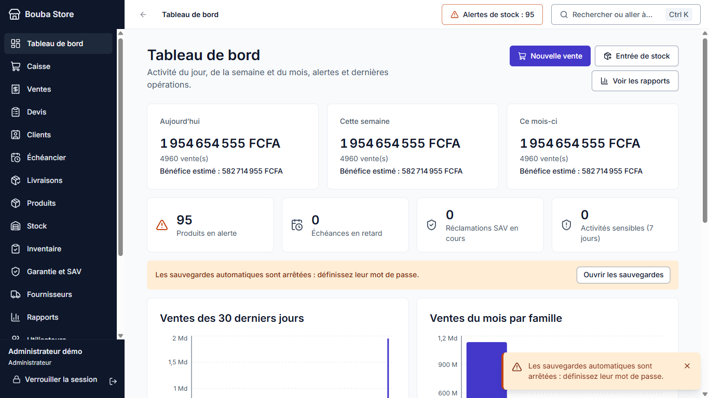
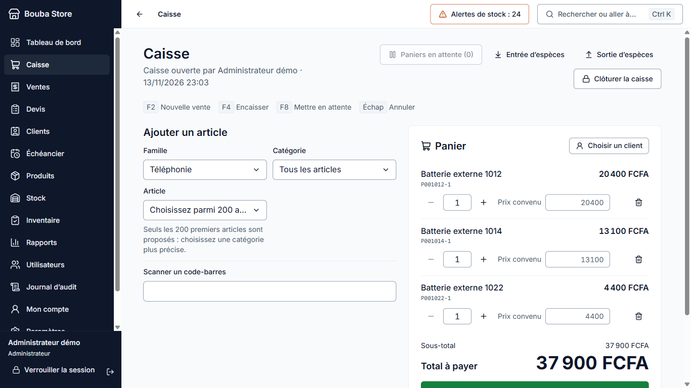
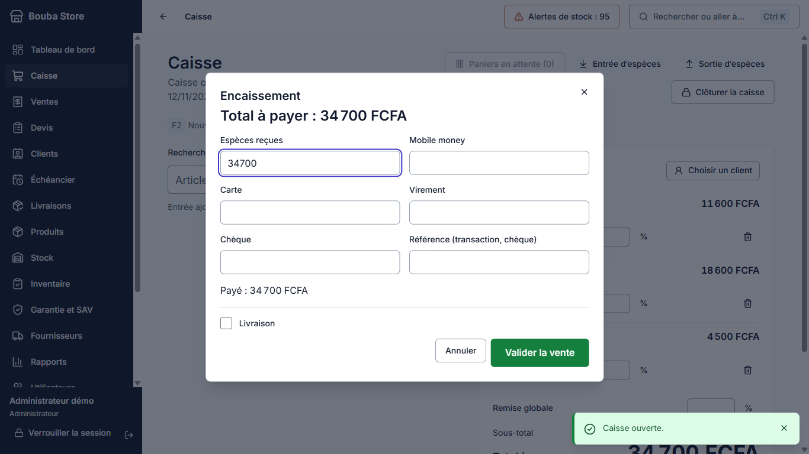
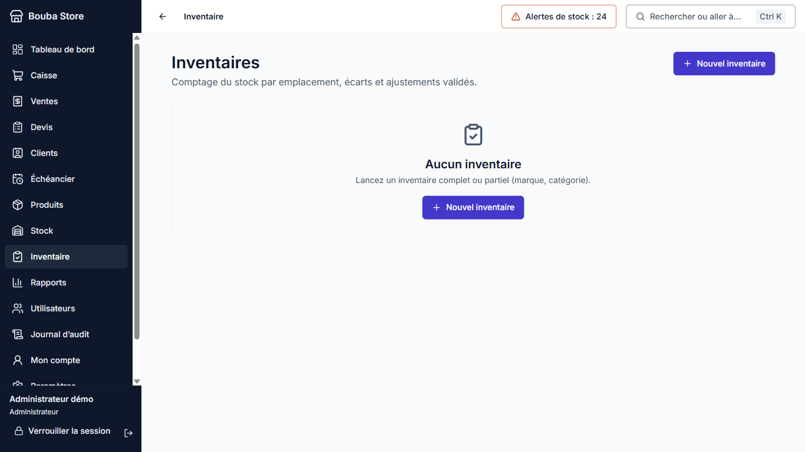
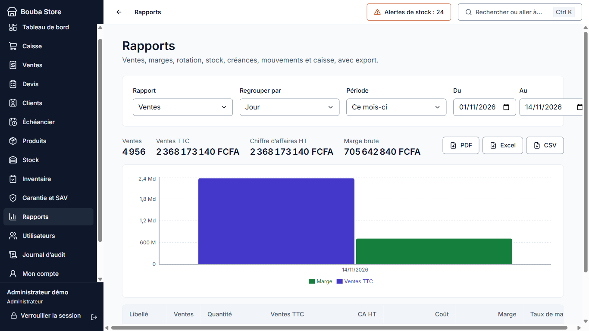
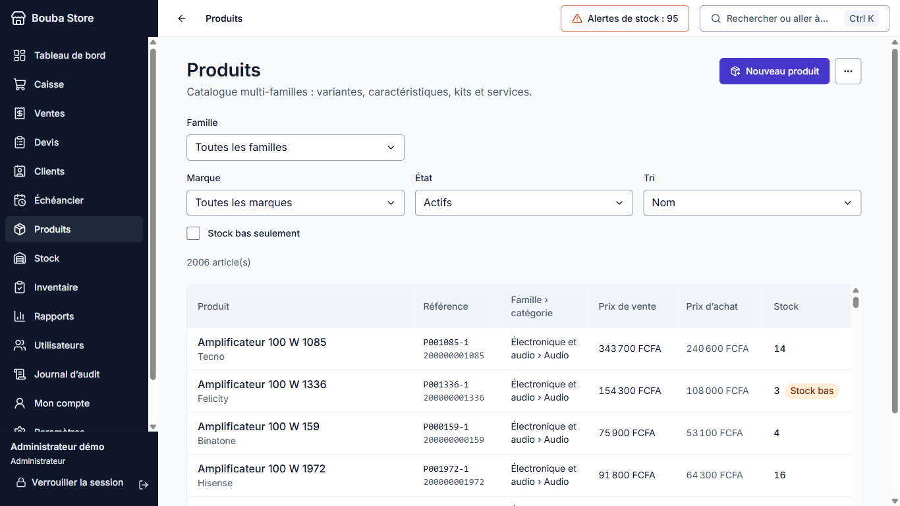
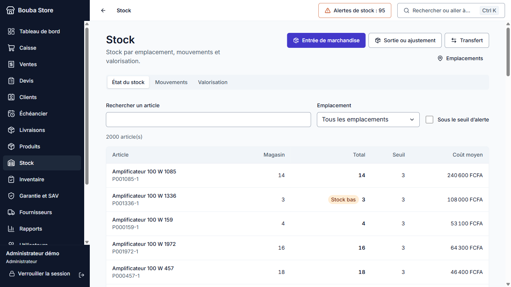
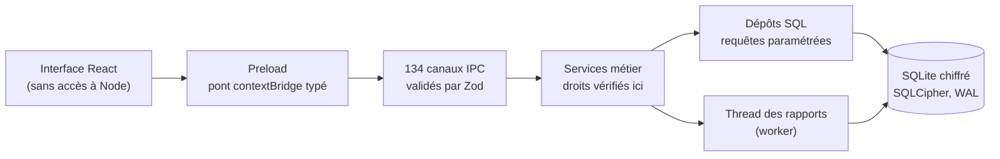

<div align="center">

# Bouba Store

**Logiciel de caisse et de gestion de boutique pour Windows : rapide, chiffré, 100 % hors ligne.**

Conçu et développé par **2KConception** pour une boutique qui vend des téléphones, de l'électronique, de
l'électroménager et des kits d'énergie solaire.




</div>

## Le projet

Une boutique d'Afrique de l'Ouest a besoin d'un outil qui fonctionne **sans connexion Internet**, encaisse en **FCFA**
et en **mobile money**, et garde ses chiffres **à l'abri** même si l'ordinateur est volé. Les solutions en ligne ne
conviennent pas : réseau instable, abonnement mensuel, données hébergées ailleurs.

Bouba Store est une application de bureau complète, installée par un simple `setup.exe`. Le vendeur choisit un
article, s'accorde sur le prix avec le client, encaisse en espèces, Orange Money, Moov Money, Telecel Money ou Wave, et
le stock, l'inventaire, la caisse et les rapports se mettent à jour d'eux-mêmes.

## Points forts

- **Caisse au clavier et au scanner** : F2 nouvelle vente, F4 encaisser, F8 mettre en attente. Les articles se
  choisissent en listes successives (Famille › Catégorie › Article), sans rien taper.
- **Prix convenu** : le vendeur saisit le prix accepté par le client ; la remise est calculée et tracée.
- **Paiement mixte et crédit** : plusieurs moyens de paiement sur une même vente, acomptes, ventes à échéancier avec
  suivi des retards.
- **Inventaire tenu automatiquement** : à partir de chaque mouvement de stock, l'application connaît pour chaque
  article le stock au début, les entrées, les ventes, les sorties et le stock restant. Le comptage physique devient un
  simple contrôle.
- **Catalogue multi-familles** : caractéristiques techniques configurables par catégorie (Wc, V, Ah, pouces…), kits
  (un kit solaire vendu décrémente chacun de ses composants, tout ou rien), services sans stock.
- **Rôles** administrateur, gérant et vendeur : un vendeur ne voit jamais les prix d'achat ni les marges, même dans les
  exports. Il peut se connecter par code PIN à la caisse et ne voit que les ventes du jour.
- **Rapports** par jour, vendeur, famille, marque ou produit, avec exports PDF, Excel et CSV.
- **Sauvegardes chiffrées** automatiques ou sur clé USB, et mise à jour de l'application par clé USB.

## Aperçu

| Caisse                                    | Encaissement                                  |
| ----------------------------------------- | --------------------------------------------- |
|          |  |
| **Inventaire automatique**                | **Rapports**                                  |
|  |          |
| **Produits**                              | **Stock**                                     |
|      |                |

## Architecture



Le code est découpé en quatre zones étanches : `src/renderer` (interface uniquement), `src/preload` (unique pont,
minimal), `src/main` (métier, base, sécurité, impression, sauvegardes) et `src/shared` (types, schémas Zod, droits des
rôles). L'interface n'a aucun accès au disque ni à la base : chaque appel passe par un contrat IPC typé de bout en bout
et validé à l'entrée.

## Défis techniques

### L'intégrité vit dans la base, pas seulement dans le code

Une erreur de programmation ne doit jamais pouvoir fausser un stock ou effacer un paiement. Les règles sont donc
écrites dans SQLite lui-même : **94 triggers**, contraintes `CHECK`, clés étrangères en `RESTRICT`, tables `STRICT`.

- Le stock n'est modifié **que** par trigger, depuis une table de mouvements, et ne peut jamais devenir négatif.
- Mouvements de stock, paiements et journal d'audit sont **immuables** : `UPDATE` et `DELETE` refusés par la base.
- Une vente terminée ne se modifie plus ; un retour ne dépasse jamais la quantité vendue.
- La numérotation des factures est **sans trou**.
- Le journal d'audit est **chaîné par SHA-256** : toute retouche d'une ligne casse la chaîne et se détecte.

### Une vente, une transaction

Panier, lignes de kit éclatées en composants, paiements, mouvements de stock et numéro de facture sont écrits dans
**une seule transaction** : tout ou rien. Les montants sont des entiers (plus petite unité de la devise), et prix,
coût et taxe sont figés dans chaque ligne pour que les rapports d'hier ne changent jamais.

### Chiffrement et récupération

La base est chiffrée avec SQLCipher. Sa clé est protégée par **DPAPI** (`safeStorage` de Windows) et n'apparaît
jamais en clair, ni sur le disque ni dans les journaux. Une **clé de récupération**, remise une seule fois au premier
lancement, permet de rouvrir la base si Windows est réinstallé. Les mots de passe sont hachés en **Argon2id**, avec
limitation des tentatives et verrouillage après inactivité.

### Durcissement d'Electron

`contextIsolation`, `sandbox`, `nodeIntegration` désactivé, CSP stricte, aucun contenu distant, navigation externe et
nouvelles fenêtres bloquées, outils de développement absents de la version installée. Les mises à jour par clé USB
contrôlent la signature et la version du setup avant de l'installer, après une sauvegarde chiffrée automatique.

### Rapide, même avec beaucoup de données

Mesuré par un test de charge sur **50 000 produits, 100 000 ventes et 500 000 mouvements** :

| Mesure                       | Objectif | Mesuré  |
| ---------------------------- | -------- | ------- |
| Recherche produit (pire cas) | < 100 ms | 10,8 ms |
| Ajout au panier              | < 50 ms  | 0,8 ms  |
| Validation d'une vente       | < 500 ms | 8 ms    |
| Ouverture de la base         | < 3 s    | 1,2 s   |

Recherche plein texte FTS5, 68 index ciblés, listes virtualisées, rapports et tableau de bord calculés dans un
**worker thread** pour que l'interface ne se fige jamais. Une première version de la recherche plein texte prenait
116 s sur 50 000 produits ; la requête réécrite répond en quelques millisecondes.

### Des migrations qui ne cassent rien

14 migrations SQL numérotées et **immuables**, générées depuis des modèles. Une sauvegarde est faite avant chaque
migration et `PRAGMA integrity_check` tourne au démarrage. Quand une contrainte doit changer, la table est
reconstruite sans perdre une ligne ni un trigger, et des tests rejouent ces migrations sur des bases déjà remplies.

### Pensé avec le client

Le logiciel a évolué au fil des essais en boutique : suppression du suivi par IMEI, jugé trop lourd à la saisie ;
fournisseurs, livraisons et garantie devenus des modules facultatifs ; prix convenu à la place d'un panneau de
remise ; inventaire automatique ; moyens de paiement locaux. Chacun de ces choix est consigné dans un
[journal de 98 décisions](docs/DECISIONS.md).

## En chiffres

| Indicateur                   | Valeur                                                                |
| ---------------------------- | --------------------------------------------------------------------- |
| Code applicatif (TypeScript) | ~40 000 lignes                                                        |
| Code de tests                | ~10 000 lignes                                                        |
| Base de données              | 41 tables, 15 vues, 94 triggers, 68 index                             |
| Canaux IPC typés et validés  | 134                                                                   |
| Tests unitaires (Vitest)     | 290+                                                                  |
| Scénarios de bout en bout    | 40, sur l'application Electron, avec contrôle d'accessibilité WCAG AA |
| Test de l'installateur       | installation silencieuse, lancement, mise à jour, désinstallation     |

## Stack

| Domaine             | Outils                                                                       |
| ------------------- | ---------------------------------------------------------------------------- |
| Application         | Electron 45, Node.js 24, TypeScript strict (aucun `any`)                     |
| Interface           | React 18, Vite, Tailwind CSS, Radix UI, lucide-react, thèmes clair et sombre |
| État et formulaires | Zustand, React Hook Form, Zod, TanStack Table et Virtual, Recharts           |
| Données             | better-sqlite3-multiple-ciphers (SQLCipher), FTS5, mode WAL                  |
| Sécurité            | Argon2id, DPAPI (`safeStorage`), SHA-256                                     |
| Documents           | pdfmake, exceljs, bwip-js (codes-barres), node-thermal-printer (ESC/POS)     |
| Livraison           | electron-builder (installateur NSIS), mise à jour par clé USB                |
| Qualité             | Vitest, Playwright, axe-core, ESLint, Prettier                               |

## Lancer le projet

Prérequis : Windows 10/11 64 bits, Node.js 24, Git.

```bash
npm ci
```

```bash
npm run dev
```

| Commande                | Effet                                                                    |
| ----------------------- | ------------------------------------------------------------------------ |
| `npm run dev`           | application en développement, rechargement à chaud                       |
| `npm test`              | tests unitaires                                                          |
| `npm run test:e2e`      | tests de bout en bout sur l'application compilée                         |
| `npm run test:load`     | test de charge (50 000 produits, 100 000 ventes)                         |
| `npm run seed`          | données de démonstration                                                 |
| `npm run dist`          | installateur `dist/Bouba-Store-Setup-<version>.exe`                      |
| `npm run test:packaged` | installe le setup en silence, teste l'application installée, désinstalle |

## Documentation

- [Mode d'emploi](docs/GUIDE_UTILISATEUR.md) ([PDF](docs/GUIDE_UTILISATEUR.pdf)) : pour le patron, le gérant et les
  vendeurs.
- [Guide technique](docs/GUIDE_TECHNIQUE.md) : architecture, sécurité, installateur, signature, mises à jour.
- [Base de données](docs/BASE_DE_DONNEES.md) : schéma et diagramme.
- [Décisions](docs/DECISIONS.md) et [avancement](PROGRESS.md) : l'historique du projet, phase par phase.

## Auteur

**2KConception** : conception, développement, tests et livraison.

© 2026 2KConception. Tous droits réservés. Logiciel propriétaire : toute copie, diffusion ou modification sans
autorisation écrite de 2KConception est interdite.
