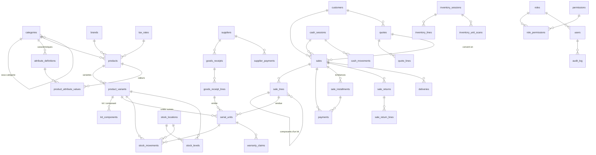

# Base de données

Une seule base SQLite chiffrée, locale, par poste : `%APPDATA%\Boutique Gestion\donnees\boutique.db`. Ce document
décrit son organisation et ses règles. Le détail colonne par colonne (40 tables, 15 vues, 99 triggers, 68 index) est
**généré** à partir des migrations dans [BASE_DE_DONNEES.schema.md](BASE_DE_DONNEES.schema.md) (`npm run docs:db`).
La conception de référence est l'Annexe E du cahier des charges ; les écarts sont notés dans
[DECISIONS.md](DECISIONS.md).

## 1. Ouverture et chiffrement

| Réglage              | Valeur                                                                                                                                                             |
| -------------------- | ------------------------------------------------------------------------------------------------------------------------------------------------------------------ |
| Chiffrement          | SQLCipher v4 (`cipher = 'sqlcipher'`, `legacy = 4` : AES-256-CBC + HMAC-SHA512 par page) (D15)                                                                     |
| Clé                  | 256 bits aléatoires, passée en clé brute `x'…'` (aucune dérivation de mot de passe)                                                                                |
| Protection de la clé | DPAPI de Windows (`safeStorage`) dans `boutique.key` ; séquestre sous la clé de récupération dans `boutique.key.recovery` (AES-256-GCM, Argon2id) (D17)            |
| À chaque ouverture   | `foreign_keys = ON`, `journal_mode = WAL`, `synchronous = FULL`, `busy_timeout = 5000`                                                                             |
| Au démarrage         | migrations en attente (copie de la base d'abord), seed système, vérification de la chaîne d'audit, `integrity_check` complet dans un thread en lecture seule (D77) |
| À la fermeture       | `PRAGMA optimize`, point de contrôle `wal_checkpoint(TRUNCATE)`                                                                                                    |

Sans la clé, le fichier est illisible (aucun en-tête SQLite en clair). La fonction SQL `audit_hash()`, exigée par le
trigger d'insertion du journal d'audit, n'existe que dans la connexion de l'application : un autre outil qui aurait la
clé ne pourrait toujours pas écrire dans le journal.

## 2. Conventions (E.1)

- Tables `STRICT`, noms en snake_case au pluriel, `id INTEGER PRIMARY KEY`.
- Dates en ISO 8601 UTC (`2026-11-12T08:30:00.000Z`), contrôlées par `CHECK … GLOB` ; jours civils en `AAAA-MM-JJ`.
- Booléens 0/1 et énumérations contrôlés par `CHECK`.
- **Montants en entiers**, dans la plus petite unité de la devise (FCFA sans décimales par défaut). Les prix sont
  TTC (D51) ; la taxe comprise est recalculée ligne par ligne avec le même arrondi que la facture.
- Clés étrangères en `ON DELETE RESTRICT` ; **aucune suppression** des données métier : archivage logique
  (`is_active`, statuts) et opérations inverses.
- Prix, coût, taxe et garantie **figés** dans les lignes de vente au moment de la vente.
- Soldes clients et fournisseurs **calculés par des vues**, jamais stockés.

## 3. Vue d'ensemble

Relations principales (les liens vers `users` — auteur, vendeur, validateur — sont omis pour la lisibilité).

## 4. Tables par domaine

| Domaine                | Tables                                                                                                                                                                                                             |
| ---------------------- | ------------------------------------------------------------------------------------------------------------------------------------------------------------------------------------------------------------------ |
| Sécurité et système    | `roles`, `permissions`, `role_permissions`, `users`, `audit_log`, `settings`, `backup_log`, `invoice_sequences` (et `schema_migrations`, tenue par l'outil de migration)                                           |
| Catalogue              | `categories` (trois niveaux, quatre familles), `brands`, `tax_rates`, `attribute_definitions`, `products`, `product_variants`, `product_attribute_values`, `kit_components`, `serial_units`, `products_fts` (FTS5) |
| Stock et achats        | `stock_locations`, `stock_movements`, `stock_levels`, `suppliers`, `goods_receipts`, `goods_receipt_lines`, `supplier_payments`                                                                                    |
| Ventes et clients      | `customers`, `cash_sessions`, `cash_movements`, `sales`, `sale_lines`, `payments`, `sale_returns`, `sale_return_lines`, `quotes`, `quote_lines`, `sale_installments`, `deliveries`                                 |
| Inventaire et garantie | `inventory_sessions`, `inventory_lines`, `inventory_unit_scans`, `warranty_claims`                                                                                                                                 |

### Familles et suivi (4.12)

- `products.product_type` : `phone`, `accessory`, `electronics`, `appliance`, `solar`, `part`, `service`, `kit`.
- `products.tracking_mode` : `none`, `serial`, `imei` ; un `phone` impose `imei`.
- `products.is_stocked` : 0 pour `service` et `kit`, qui n'ont pas de stock propre.
- `serial_units.serial_number` : unique (IMEI 1 pour un téléphone, contrôle de Luhn seulement en mode `imei`),
  `imei2` facultatif et unique, `warranty_end` fixée à la vente, statut (`in_stock`, `reserved`, `sold`, `returned`,
  `defective`, `supplier_returned`, `written_off`) dont les transitions sont contrôlées par trigger.
- Caractéristiques : `attribute_definitions` par catégorie (héritées par les sous-catégories ; types texte, nombre,
  liste, oui/non ; unité ; obligatoire ; filtrable) et `product_attribute_values` typées, indexées pour les filtres.
- Kits : `kit_components` (variante kit, variante composant, quantité) ; un kit ne contient pas de kit. À la vente,
  une ligne `kit` porte le prix et des lignes `kit_component` (`parent_line_id`) portent les sorties de stock.

## 5. Règles portées par la base (E.4)

Les règles d'intégrité vivent **dans la base** ; le code les vérifie aussi pour donner un message clair, mais une
écriture qui les contourne est refusée par SQLite.

| Règle                                                                                                        | Mécanisme                                                                                                                                                                             |
| ------------------------------------------------------------------------------------------------------------ | ------------------------------------------------------------------------------------------------------------------------------------------------------------------------------------- |
| Stock tenu uniquement par les mouvements, jamais négatif                                                     | `trg_stock_movements_check` (stock suffisant, quantité après cohérente), `trg_stock_movements_apply` (met à jour `stock_levels`), gardes sur `stock_levels` (aucune écriture directe) |
| Mouvements, paiements, retours, audit immuables                                                              | triggers `BEFORE UPDATE` / `BEFORE DELETE` qui lèvent une erreur                                                                                                                      |
| Aucune suppression des données métier                                                                        | triggers `*_no_delete` sur chaque table métier                                                                                                                                        |
| Article suivi : mouvement à l'unité, unité de la bonne variante                                              | `trg_stock_movements_check`                                                                                                                                                           |
| Un IMEI ou un numéro de série une seule fois ; Luhn en mode IMEI                                             | index uniques, `trg_serial_units_format_insert`                                                                                                                                       |
| Vente terminée ou annulée non modifiable ; totaux, paiements et unités cohérents à la validation             | triggers sur `sales`, `sale_lines`, `payments`                                                                                                                                        |
| Retour ≤ quantité vendue                                                                                     | trigger sur `sale_return_lines`                                                                                                                                                       |
| Plafond de crédit client, plafonds de remise par rôle (D52), annulation limitée à la session de caisse (D53) | triggers de la migration 0008                                                                                                                                                         |
| Factures numérotées sans trou ni doublon                                                                     | `invoice_sequences`, incrément dans la transaction de la vente                                                                                                                        |
| Entrée de marchandise validée non modifiable, total égal aux lignes                                          | `trg_goods_receipts_status`, `trg_goods_receipts_total`, gardes sur les lignes                                                                                                        |
| Livraison faite ou annulée non modifiable                                                                    | `trg_deliveries_final`                                                                                                                                                                |
| Client anonymisé sans téléphone, adresse ni notes                                                            | `CHECK` sur `customers`                                                                                                                                                               |
| Journal d'audit chaîné                                                                                       | `prev_hash` / `hash` (SHA-256) calculés par `audit_hash()` à l'insertion ; vérification au démarrage et à la demande                                                                  |
| Dernier administrateur actif protégé                                                                         | trigger sur `users`                                                                                                                                                                   |

## 6. Vues (E.6)

| Vue                      | Usage                                                                                            |
| ------------------------ | ------------------------------------------------------------------------------------------------ |
| `v_stock_overview`       | stock par variante, tous emplacements, avec seuil d'alerte                                       |
| `v_stock_by_location`    | stock par variante et par emplacement                                                            |
| `v_low_stock`            | articles sous le seuil d'alerte                                                                  |
| `v_stock_discrepancies`  | contrôle : écarts entre `stock_levels` et la somme des mouvements (doit être vide)               |
| `v_customer_balances`    | reste dû par client (ventes à crédit − paiements − avoirs)                                       |
| `v_supplier_balances`    | reste dû à chaque fournisseur                                                                    |
| `v_sale_lines_net`       | lignes vendues nettes des retours, HT, coût et marge (kits valorisés par leurs composants) (D64) |
| `v_sales_by_family`      | ventes et marges par famille                                                                     |
| `v_daily_sales`          | ventes par jour                                                                                  |
| `v_sales_margin`         | marge par vente                                                                                  |
| `v_category_families`    | famille de premier niveau de chaque catégorie                                                    |
| `v_cash_session_summary` | totaux par moyen de paiement et écart d'une session de caisse                                    |
| `v_open_quotes`          | devis en cours                                                                                   |
| `v_overdue_installments` | échéances en retard                                                                              |
| `v_warranty_expiring`    | garanties qui expirent bientôt                                                                   |

Les coûts et les marges ne sortent de ces vues que vers un utilisateur qui a la permission `cost.view` : le filtrage se
fait dans les services, y compris pour les exports.

## 7. Index et recherche (E.5)

- Index sur les codes-barres, références, IMEI et numéros de série, noms, marques, catégories, dates de vente et de
  mouvement, statuts ; index partiels sur les clés étrangères consultées le plus souvent vides (migration 0011, D81).
- `products_fts` (FTS5, sans accents, recherche par préfixes) tenue à jour par triggers sur `products` et
  `product_variants`. Mesuré : < 11 ms sur 50 000 produits.

## 8. Migrations et données initiales (E.7)

- Fichiers numérotés dans `db/migrations` (`0001` à `0011`), **générés** depuis `db/templates` par
  `node scripts/build-migrations.mjs` (macros pour les contrôles de date et de Luhn). Le script refuse de modifier une
  migration existante dont le contenu changerait.
- Une migration appliquée est **immuable** : son empreinte est vérifiée à chaque démarrage ; toute évolution passe par
  une nouvelle migration.
- Avant d'appliquer une migration, une copie chiffrée de la base est faite dans `donnees\sauvegardes`
  (`avant-migration-…`) et inscrite dans `backup_log`. Chaque migration s'applique dans une transaction : en cas
  d'échec, la base reste dans son état précédent.
- Le **seed système** (idempotent) crée les rôles et permissions (repris de `src/shared/permissions.ts`), les quatre
  familles, les taux de taxe (Exonéré, TVA 18 %), l'emplacement « Magasin » et les paramètres par défaut. Il ne crée
  aucune donnée de démonstration : celles-ci passent par `npm run seed`, hors de l'application installée (D76).

| Migration | Contenu                                                                             |
| --------- | ----------------------------------------------------------------------------------- |
| 0001      | sécurité et système : rôles, utilisateurs, audit, paramètres, sauvegardes, factures |
| 0002      | catalogue, caractéristiques, kits, unités suivies, recherche FTS5                   |
| 0003      | stock, emplacements, fournisseurs, entrées de marchandise                           |
| 0004      | clients, caisse, ventes, paiements, retours, devis, échéances, livraisons           |
| 0005      | inventaire, garantie                                                                |
| 0006      | vues de lecture                                                                     |
| 0007      | états « rendu au fournisseur » et « sorti du stock » des unités (D43)               |
| 0008      | plafonds de remise par rôle, annulation limitée à la session de caisse              |
| 0009      | appareils scannés pendant un inventaire (D60)                                       |
| 0010      | vues de ventes et de marges hors taxe nettes des retours (D64)                      |
| 0011      | index des clés étrangères consultées (D81)                                          |

## 9. Sauvegarde et restauration

- **Copie cohérente** par `VACUUM INTO`, base ouverte, dans le thread des rapports (connexion en lecture seule) : la
  caisse n'est pas bloquée (D71). Mesuré : 6 s pour la base de charge.
- **Fichier `.bgsauv`** : en-tête lisible et authentifié (date, boutique, versions, paramètres Argon2id), puis contenu
  AES-256-GCM (copie de la base, sa clé, le séquestre), avec une clé dérivée du mot de passe des sauvegardes par
  Argon2id (64 Mio, 3 passes) (D70).
- **Restauration** : étiquette GCM, empreinte SHA-256, version du schéma, ouverture et `integrity_check` de la copie
  avant de toucher à la base courante ; copie de sécurité d'abord ; base remplacée mise de côté (D73).

## 10. Tests de la base (E.8)

`tests/unit/db` vérifie chaque contrainte de l'E.8 (stock négatif, mouvements immuables, IMEI en double, retour
au-delà du vendu, vente terminée modifiée, facture sans trou, chaîne d'audit altérée, chiffrement), les migrations
sur une base existante et la cohérence `v_stock_discrepancies`. Le test de charge (`npm run test:load`) vérifie ces
règles sur 50 000 produits, 98 746 ventes et 522 361 mouvements.
