# Schéma de la base (généré)

Fichier produit par `npm run docs:db` à partir des migrations de `db/migrations` : ne pas modifier à la main.

40 tables, 15 vues, 99 triggers, 68 index.

## Diagramme

```mermaid
erDiagram
  attribute_definitions {
    INTEGER id PK
    INTEGER category_id FK
    TEXT code
    TEXT label
    TEXT value_type
    TEXT unit
    TEXT choices
    INTEGER is_required
    INTEGER is_filterable
    INTEGER sort_order
    INTEGER is_active
    TEXT created_at
    TEXT updated_at
    INTEGER created_by FK
  }
  audit_log {
    INTEGER id PK
    INTEGER user_id FK
    TEXT action
    TEXT entity_type
    INTEGER entity_id
    TEXT details
    TEXT created_at
    TEXT prev_hash
    TEXT hash
  }
  backup_log {
    INTEGER id PK
    TEXT type
    TEXT path
    INTEGER size_bytes
    TEXT checksum
    TEXT status
    TEXT created_at
  }
  brands {
    INTEGER id PK
    TEXT name
    TEXT logo_path
    INTEGER is_active
    TEXT created_at
    TEXT updated_at
    INTEGER created_by FK
  }
  cash_movements {
    INTEGER id PK
    INTEGER cash_session_id FK
    TEXT direction
    INTEGER amount
    TEXT reason
    INTEGER user_id FK
    TEXT created_at
  }
  cash_sessions {
    INTEGER id PK
    INTEGER opened_by FK
    TEXT opened_at
    INTEGER opening_float
    INTEGER closed_by FK
    TEXT closed_at
    INTEGER expected_amount
    INTEGER counted_amount
    INTEGER difference
    TEXT status
  }
  categories {
    INTEGER id PK
    TEXT name
    INTEGER parent_id FK
    TEXT default_tracking_mode
    INTEGER default_warranty_months
    INTEGER sort_order
    INTEGER is_active
    TEXT created_at
    TEXT updated_at
    INTEGER created_by FK
  }
  customers {
    INTEGER id PK
    TEXT full_name
    TEXT phone
    TEXT address
    INTEGER credit_limit
    TEXT notes
    INTEGER is_active
    TEXT anonymized_at
    TEXT created_at
    TEXT updated_at
    INTEGER created_by FK
  }
  deliveries {
    INTEGER id PK
    INTEGER sale_id FK
    TEXT address
    TEXT status
    TEXT scheduled_at
    TEXT delivered_at
    INTEGER delivered_by FK
    TEXT notes
    TEXT created_at
    TEXT updated_at
    INTEGER created_by FK
  }
  goods_receipt_lines {
    INTEGER id PK
    INTEGER receipt_id FK
    INTEGER variant_id FK
    INTEGER quantity
    INTEGER unit_cost
  }
  goods_receipts {
    INTEGER id PK
    TEXT number
    INTEGER supplier_id FK
    INTEGER location_id FK
    TEXT received_at
    INTEGER total_cost
    TEXT status
    TEXT notes
    INTEGER user_id FK
    TEXT validated_at
    TEXT created_at
    TEXT updated_at
    INTEGER created_by FK
  }
  inventory_lines {
    INTEGER id PK
    INTEGER session_id FK
    INTEGER variant_id FK
    INTEGER location_id FK
    INTEGER expected_quantity
    INTEGER counted_quantity
    INTEGER difference
    TEXT note
  }
  inventory_sessions {
    INTEGER id PK
    TEXT name
    TEXT scope_type
    INTEGER scope_id
    INTEGER location_id FK
    TEXT status
    INTEGER created_by FK
    INTEGER validated_by FK
    TEXT created_at
    TEXT updated_at
    TEXT validated_at
  }
  inventory_unit_scans {
    INTEGER id PK
    INTEGER session_id FK
    INTEGER serial_unit_id FK
    INTEGER user_id FK
    TEXT scanned_at
  }
  invoice_sequences {
    INTEGER year PK
    INTEGER last_number
  }
  kit_components {
    INTEGER id PK
    INTEGER kit_variant_id FK
    INTEGER component_variant_id FK
    INTEGER quantity
    TEXT created_at
    TEXT updated_at
    INTEGER created_by FK
  }
  payments {
    INTEGER id PK
    INTEGER sale_id FK
    INTEGER installment_id FK
    TEXT method
    INTEGER amount
    TEXT reference
    INTEGER cash_session_id FK
    INTEGER user_id FK
    TEXT paid_at
  }
  permissions {
    INTEGER id PK
    TEXT code
    TEXT description
  }
  product_attribute_values {
    INTEGER product_id PK, FK
    INTEGER attribute_id PK, FK
    TEXT value_text
    REAL value_number
  }
  product_variants {
    INTEGER id PK
    INTEGER product_id FK
    TEXT sku
    TEXT barcode
    TEXT color
    INTEGER storage_gb
    INTEGER ram_gb
    TEXT condition
    INTEGER cost_price
    INTEGER avg_cost
    INTEGER sale_price
    INTEGER min_sale_price
    INTEGER is_active
    TEXT created_at
    TEXT updated_at
    INTEGER created_by FK
  }
  products {
    INTEGER id PK
    TEXT name
    INTEGER brand_id FK
    INTEGER category_id FK
    TEXT model
    TEXT description
    TEXT product_type
    TEXT tracking_mode
    INTEGER is_stocked
    INTEGER tax_rate_id FK
    INTEGER reorder_level
    INTEGER warranty_months
    REAL weight_kg
    TEXT image_path
    INTEGER is_active
    TEXT created_at
    TEXT updated_at
    INTEGER created_by FK
  }
  quote_lines {
    INTEGER id PK
    INTEGER quote_id FK
    INTEGER variant_id FK
    INTEGER serial_unit_id FK
    TEXT description
    INTEGER quantity
    INTEGER unit_price
    INTEGER discount
    INTEGER tax_rate
    INTEGER line_total
  }
  quotes {
    INTEGER id PK
    TEXT number
    INTEGER customer_id FK
    INTEGER user_id FK
    TEXT status
    TEXT valid_until
    INTEGER subtotal
    INTEGER discount_total
    INTEGER tax_total
    INTEGER total
    INTEGER reserve_stock
    TEXT notes
    INTEGER converted_sale_id FK
    TEXT created_at
    TEXT updated_at
    INTEGER created_by FK
  }
  role_permissions {
    INTEGER role_id PK, FK
    INTEGER permission_id PK, FK
  }
  roles {
    INTEGER id PK
    TEXT code
    TEXT name
  }
  sale_installments {
    INTEGER id PK
    INTEGER sale_id FK
    TEXT due_date
    INTEGER amount
    INTEGER paid_amount
    TEXT status
    TEXT created_at
    TEXT updated_at
    INTEGER created_by FK
  }
  sale_lines {
    INTEGER id PK
    INTEGER sale_id FK
    INTEGER variant_id FK
    INTEGER serial_unit_id FK
    INTEGER parent_line_id FK
    TEXT line_type
    INTEGER quantity
    INTEGER unit_price
    INTEGER unit_cost
    INTEGER discount
    INTEGER tax_rate
    INTEGER line_total
  }
  sale_return_lines {
    INTEGER id PK
    INTEGER return_id FK
    INTEGER sale_line_id FK
    INTEGER quantity
    INTEGER restock
    INTEGER amount
  }
  sale_returns {
    INTEGER id PK
    TEXT number
    INTEGER sale_id FK
    TEXT reason
    INTEGER refund_amount
    TEXT refund_method
    INTEGER cash_session_id FK
    INTEGER user_id FK
    TEXT created_at
  }
  sales {
    INTEGER id PK
    TEXT invoice_number
    TEXT status
    INTEGER customer_id FK
    INTEGER user_id FK
    INTEGER cash_session_id FK
    INTEGER quote_id FK
    INTEGER subtotal
    INTEGER discount_total
    INTEGER tax_total
    INTEGER total
    INTEGER amount_paid
    TEXT due_date
    INTEGER delivery_required
    TEXT created_at
    TEXT updated_at
    TEXT completed_at
    TEXT cancelled_at
    TEXT cancel_reason
    INTEGER cancelled_by FK
  }
  serial_units {
    INTEGER id PK
    INTEGER variant_id FK
    TEXT serial_number
    TEXT imei2
    TEXT status
    INTEGER receipt_line_id FK
    INTEGER sale_line_id FK
    TEXT received_at
    TEXT sold_at
    TEXT warranty_end
    TEXT created_at
    TEXT updated_at
    INTEGER created_by FK
  }
  settings {
    TEXT key PK
    TEXT value
    TEXT updated_at
    INTEGER updated_by FK
  }
  stock_levels {
    INTEGER variant_id PK, FK
    INTEGER location_id PK, FK
    INTEGER quantity
  }
  stock_locations {
    INTEGER id PK
    TEXT name
    INTEGER is_default
    INTEGER is_active
    TEXT created_at
    TEXT updated_at
    INTEGER created_by FK
  }
  stock_movements {
    INTEGER id PK
    INTEGER variant_id FK
    INTEGER location_id FK
    INTEGER serial_unit_id FK
    TEXT movement_type
    INTEGER quantity_delta
    INTEGER unit_cost
    INTEGER quantity_after
    TEXT reference_type
    INTEGER reference_id
    TEXT reason
    INTEGER user_id FK
    TEXT created_at
  }
  supplier_payments {
    INTEGER id PK
    INTEGER supplier_id FK
    INTEGER receipt_id FK
    INTEGER amount
    TEXT method
    TEXT reference
    TEXT paid_at
    INTEGER user_id FK
    TEXT created_at
  }
  suppliers {
    INTEGER id PK
    TEXT name
    TEXT phone
    TEXT email
    TEXT address
    TEXT notes
    INTEGER is_active
    TEXT created_at
    TEXT updated_at
    INTEGER created_by FK
  }
  tax_rates {
    INTEGER id PK
    TEXT name
    INTEGER rate
    INTEGER is_active
    TEXT created_at
    TEXT updated_at
    INTEGER created_by FK
  }
  users {
    INTEGER id PK
    TEXT username
    TEXT full_name
    TEXT password_hash
    TEXT pin_hash
    INTEGER role_id FK
    INTEGER is_active
    INTEGER must_change_password
    INTEGER failed_attempts
    TEXT locked_until
    INTEGER pin_failed_attempts
    TEXT pin_locked_until
    TEXT last_login_at
    TEXT created_at
    TEXT updated_at
    INTEGER created_by FK
  }
  warranty_claims {
    INTEGER id PK
    INTEGER serial_unit_id FK
    INTEGER sale_id FK
    INTEGER customer_id FK
    INTEGER supplier_id FK
    TEXT issue
    TEXT status
    TEXT resolution
    INTEGER warranty_expired
    TEXT opened_at
    TEXT closed_at
    INTEGER user_id FK
    TEXT updated_at
  }
  users ||--o{ attribute_definitions : "created_by"
  categories ||--o{ attribute_definitions : "category_id"
  users ||--o{ audit_log : "user_id"
  users ||--o{ brands : "created_by"
  users ||--o{ cash_movements : "user_id"
  cash_sessions ||--o{ cash_movements : "cash_session_id"
  users ||--o{ cash_sessions : "closed_by"
  users ||--o{ cash_sessions : "opened_by"
  users ||--o{ categories : "created_by"
  categories ||--o{ categories : "parent_id"
  users ||--o{ customers : "created_by"
  users ||--o{ deliveries : "created_by"
  users ||--o{ deliveries : "delivered_by"
  sales ||--o{ deliveries : "sale_id"
  product_variants ||--o{ goods_receipt_lines : "variant_id"
  goods_receipts ||--o{ goods_receipt_lines : "receipt_id"
  users ||--o{ goods_receipts : "created_by"
  users ||--o{ goods_receipts : "user_id"
  stock_locations ||--o{ goods_receipts : "location_id"
  suppliers ||--o{ goods_receipts : "supplier_id"
  stock_locations ||--o{ inventory_lines : "location_id"
  product_variants ||--o{ inventory_lines : "variant_id"
  inventory_sessions ||--o{ inventory_lines : "session_id"
  users ||--o{ inventory_sessions : "validated_by"
  users ||--o{ inventory_sessions : "created_by"
  stock_locations ||--o{ inventory_sessions : "location_id"
  users ||--o{ inventory_unit_scans : "user_id"
  serial_units ||--o{ inventory_unit_scans : "serial_unit_id"
  inventory_sessions ||--o{ inventory_unit_scans : "session_id"
  users ||--o{ kit_components : "created_by"
  product_variants ||--o{ kit_components : "component_variant_id"
  product_variants ||--o{ kit_components : "kit_variant_id"
  users ||--o{ payments : "user_id"
  cash_sessions ||--o{ payments : "cash_session_id"
  sale_installments ||--o{ payments : "installment_id"
  sales ||--o{ payments : "sale_id"
  attribute_definitions ||--o{ product_attribute_values : "attribute_id"
  products ||--o{ product_attribute_values : "product_id"
  users ||--o{ product_variants : "created_by"
  products ||--o{ product_variants : "product_id"
  users ||--o{ products : "created_by"
  tax_rates ||--o{ products : "tax_rate_id"
  categories ||--o{ products : "category_id"
  brands ||--o{ products : "brand_id"
  serial_units ||--o{ quote_lines : "serial_unit_id"
  product_variants ||--o{ quote_lines : "variant_id"
  quotes ||--o{ quote_lines : "quote_id"
  users ||--o{ quotes : "created_by"
  sales ||--o{ quotes : "converted_sale_id"
  users ||--o{ quotes : "user_id"
  customers ||--o{ quotes : "customer_id"
  permissions ||--o{ role_permissions : "permission_id"
  roles ||--o{ role_permissions : "role_id"
  users ||--o{ sale_installments : "created_by"
  sales ||--o{ sale_installments : "sale_id"
  sale_lines ||--o{ sale_lines : "parent_line_id"
  serial_units ||--o{ sale_lines : "serial_unit_id"
  product_variants ||--o{ sale_lines : "variant_id"
  sales ||--o{ sale_lines : "sale_id"
  sale_lines ||--o{ sale_return_lines : "sale_line_id"
  sale_returns ||--o{ sale_return_lines : "return_id"
  users ||--o{ sale_returns : "user_id"
  cash_sessions ||--o{ sale_returns : "cash_session_id"
  sales ||--o{ sale_returns : "sale_id"
  users ||--o{ sales : "cancelled_by"
  quotes ||--o{ sales : "quote_id"
  cash_sessions ||--o{ sales : "cash_session_id"
  users ||--o{ sales : "user_id"
  customers ||--o{ sales : "customer_id"
  users ||--o{ serial_units : "created_by"
  sale_lines ||--o{ serial_units : "sale_line_id"
  goods_receipt_lines ||--o{ serial_units : "receipt_line_id"
  product_variants ||--o{ serial_units : "variant_id"
  users ||--o{ settings : "updated_by"
  stock_locations ||--o{ stock_levels : "location_id"
  product_variants ||--o{ stock_levels : "variant_id"
  users ||--o{ stock_locations : "created_by"
  users ||--o{ stock_movements : "user_id"
  serial_units ||--o{ stock_movements : "serial_unit_id"
  stock_locations ||--o{ stock_movements : "location_id"
  product_variants ||--o{ stock_movements : "variant_id"
  users ||--o{ supplier_payments : "user_id"
  goods_receipts ||--o{ supplier_payments : "receipt_id"
  suppliers ||--o{ supplier_payments : "supplier_id"
  users ||--o{ suppliers : "created_by"
  users ||--o{ tax_rates : "created_by"
  users ||--o{ users : "created_by"
  roles ||--o{ users : "role_id"
  users ||--o{ warranty_claims : "user_id"
  suppliers ||--o{ warranty_claims : "supplier_id"
  customers ||--o{ warranty_claims : "customer_id"
  sales ||--o{ warranty_claims : "sale_id"
  serial_units ||--o{ warranty_claims : "serial_unit_id"
```

## Tables

### attribute_definitions

| Colonne       | Type    | Nulle | Défaut                                  | Référence     |
| ------------- | ------- | ----- | --------------------------------------- | ------------- |
| id (clé)      | INTEGER | non   |                                         |               |
| category_id   | INTEGER | non   |                                         | categories.id |
| code          | TEXT    | non   |                                         |               |
| label         | TEXT    | non   |                                         |               |
| value_type    | TEXT    | non   |                                         |               |
| unit          | TEXT    | oui   |                                         |               |
| choices       | TEXT    | oui   |                                         |               |
| is_required   | INTEGER | non   | `0`                                     |               |
| is_filterable | INTEGER | non   | `0`                                     |               |
| sort_order    | INTEGER | non   | `0`                                     |               |
| is_active     | INTEGER | non   | `1`                                     |               |
| created_at    | TEXT    | non   | `strftime('%Y-%m-%dT%H:%M:%fZ', 'now')` |               |
| updated_at    | TEXT    | non   | `strftime('%Y-%m-%dT%H:%M:%fZ', 'now')` |               |
| created_by    | INTEGER | oui   |                                         | users.id      |

### audit_log

| Colonne     | Type    | Nulle | Défaut | Référence |
| ----------- | ------- | ----- | ------ | --------- |
| id (clé)    | INTEGER | non   |        |           |
| user_id     | INTEGER | oui   |        | users.id  |
| action      | TEXT    | non   |        |           |
| entity_type | TEXT    | oui   |        |           |
| entity_id   | INTEGER | oui   |        |           |
| details     | TEXT    | non   | `'{}'` |           |
| created_at  | TEXT    | non   |        |           |
| prev_hash   | TEXT    | non   |        |           |
| hash        | TEXT    | non   |        |           |

### backup_log

| Colonne    | Type    | Nulle | Défaut                                  | Référence |
| ---------- | ------- | ----- | --------------------------------------- | --------- |
| id (clé)   | INTEGER | non   |                                         |           |
| type       | TEXT    | non   |                                         |           |
| path       | TEXT    | non   |                                         |           |
| size_bytes | INTEGER | non   |                                         |           |
| checksum   | TEXT    | non   |                                         |           |
| status     | TEXT    | non   |                                         |           |
| created_at | TEXT    | non   | `strftime('%Y-%m-%dT%H:%M:%fZ', 'now')` |           |

### brands

| Colonne    | Type    | Nulle | Défaut                                  | Référence |
| ---------- | ------- | ----- | --------------------------------------- | --------- |
| id (clé)   | INTEGER | non   |                                         |           |
| name       | TEXT    | non   |                                         |           |
| logo_path  | TEXT    | oui   |                                         |           |
| is_active  | INTEGER | non   | `1`                                     |           |
| created_at | TEXT    | non   | `strftime('%Y-%m-%dT%H:%M:%fZ', 'now')` |           |
| updated_at | TEXT    | non   | `strftime('%Y-%m-%dT%H:%M:%fZ', 'now')` |           |
| created_by | INTEGER | oui   |                                         | users.id  |

### cash_movements

| Colonne         | Type    | Nulle | Défaut                                  | Référence        |
| --------------- | ------- | ----- | --------------------------------------- | ---------------- |
| id (clé)        | INTEGER | non   |                                         |                  |
| cash_session_id | INTEGER | non   |                                         | cash_sessions.id |
| direction       | TEXT    | non   |                                         |                  |
| amount          | INTEGER | non   |                                         |                  |
| reason          | TEXT    | non   |                                         |                  |
| user_id         | INTEGER | non   |                                         | users.id         |
| created_at      | TEXT    | non   | `strftime('%Y-%m-%dT%H:%M:%fZ', 'now')` |                  |

### cash_sessions

| Colonne         | Type    | Nulle | Défaut                                  | Référence |
| --------------- | ------- | ----- | --------------------------------------- | --------- |
| id (clé)        | INTEGER | non   |                                         |           |
| opened_by       | INTEGER | non   |                                         | users.id  |
| opened_at       | TEXT    | non   | `strftime('%Y-%m-%dT%H:%M:%fZ', 'now')` |           |
| opening_float   | INTEGER | non   |                                         |           |
| closed_by       | INTEGER | oui   |                                         | users.id  |
| closed_at       | TEXT    | oui   |                                         |           |
| expected_amount | INTEGER | oui   |                                         |           |
| counted_amount  | INTEGER | oui   |                                         |           |
| difference      | INTEGER | oui   |                                         |           |
| status          | TEXT    | non   | `'open'`                                |           |

### categories

| Colonne                 | Type    | Nulle | Défaut                                  | Référence     |
| ----------------------- | ------- | ----- | --------------------------------------- | ------------- |
| id (clé)                | INTEGER | non   |                                         |               |
| name                    | TEXT    | non   |                                         |               |
| parent_id               | INTEGER | oui   |                                         | categories.id |
| default_tracking_mode   | TEXT    | non   | `'none'`                                |               |
| default_warranty_months | INTEGER | non   | `0`                                     |               |
| sort_order              | INTEGER | non   | `0`                                     |               |
| is_active               | INTEGER | non   | `1`                                     |               |
| created_at              | TEXT    | non   | `strftime('%Y-%m-%dT%H:%M:%fZ', 'now')` |               |
| updated_at              | TEXT    | non   | `strftime('%Y-%m-%dT%H:%M:%fZ', 'now')` |               |
| created_by              | INTEGER | oui   |                                         | users.id      |

### customers

| Colonne       | Type    | Nulle | Défaut                                  | Référence |
| ------------- | ------- | ----- | --------------------------------------- | --------- |
| id (clé)      | INTEGER | non   |                                         |           |
| full_name     | TEXT    | non   |                                         |           |
| phone         | TEXT    | oui   |                                         |           |
| address       | TEXT    | oui   |                                         |           |
| credit_limit  | INTEGER | non   | `0`                                     |           |
| notes         | TEXT    | oui   |                                         |           |
| is_active     | INTEGER | non   | `1`                                     |           |
| anonymized_at | TEXT    | oui   |                                         |           |
| created_at    | TEXT    | non   | `strftime('%Y-%m-%dT%H:%M:%fZ', 'now')` |           |
| updated_at    | TEXT    | non   | `strftime('%Y-%m-%dT%H:%M:%fZ', 'now')` |           |
| created_by    | INTEGER | oui   |                                         | users.id  |

### deliveries

| Colonne      | Type    | Nulle | Défaut                                  | Référence |
| ------------ | ------- | ----- | --------------------------------------- | --------- |
| id (clé)     | INTEGER | non   |                                         |           |
| sale_id      | INTEGER | non   |                                         | sales.id  |
| address      | TEXT    | non   |                                         |           |
| status       | TEXT    | non   | `'to_deliver'`                          |           |
| scheduled_at | TEXT    | oui   |                                         |           |
| delivered_at | TEXT    | oui   |                                         |           |
| delivered_by | INTEGER | oui   |                                         | users.id  |
| notes        | TEXT    | oui   |                                         |           |
| created_at   | TEXT    | non   | `strftime('%Y-%m-%dT%H:%M:%fZ', 'now')` |           |
| updated_at   | TEXT    | non   | `strftime('%Y-%m-%dT%H:%M:%fZ', 'now')` |           |
| created_by   | INTEGER | oui   |                                         | users.id  |

### goods_receipt_lines

| Colonne    | Type    | Nulle | Défaut | Référence           |
| ---------- | ------- | ----- | ------ | ------------------- |
| id (clé)   | INTEGER | non   |        |                     |
| receipt_id | INTEGER | non   |        | goods_receipts.id   |
| variant_id | INTEGER | non   |        | product_variants.id |
| quantity   | INTEGER | non   |        |                     |
| unit_cost  | INTEGER | non   |        |                     |

### goods_receipts

| Colonne      | Type    | Nulle | Défaut                                  | Référence          |
| ------------ | ------- | ----- | --------------------------------------- | ------------------ |
| id (clé)     | INTEGER | non   |                                         |                    |
| number       | TEXT    | non   |                                         |                    |
| supplier_id  | INTEGER | non   |                                         | suppliers.id       |
| location_id  | INTEGER | non   |                                         | stock_locations.id |
| received_at  | TEXT    | non   |                                         |                    |
| total_cost   | INTEGER | non   | `0`                                     |                    |
| status       | TEXT    | non   | `'draft'`                               |                    |
| notes        | TEXT    | oui   |                                         |                    |
| user_id      | INTEGER | non   |                                         | users.id           |
| validated_at | TEXT    | oui   |                                         |                    |
| created_at   | TEXT    | non   | `strftime('%Y-%m-%dT%H:%M:%fZ', 'now')` |                    |
| updated_at   | TEXT    | non   | `strftime('%Y-%m-%dT%H:%M:%fZ', 'now')` |                    |
| created_by   | INTEGER | oui   |                                         | users.id           |

### inventory_lines

| Colonne           | Type    | Nulle | Défaut | Référence             |
| ----------------- | ------- | ----- | ------ | --------------------- |
| id (clé)          | INTEGER | non   |        |                       |
| session_id        | INTEGER | non   |        | inventory_sessions.id |
| variant_id        | INTEGER | non   |        | product_variants.id   |
| location_id       | INTEGER | non   |        | stock_locations.id    |
| expected_quantity | INTEGER | non   |        |                       |
| counted_quantity  | INTEGER | oui   |        |                       |
| difference        | INTEGER | oui   |        |                       |
| note              | TEXT    | oui   |        |                       |

### inventory_sessions

| Colonne      | Type    | Nulle | Défaut                                  | Référence          |
| ------------ | ------- | ----- | --------------------------------------- | ------------------ |
| id (clé)     | INTEGER | non   |                                         |                    |
| name         | TEXT    | non   |                                         |                    |
| scope_type   | TEXT    | non   |                                         |                    |
| scope_id     | INTEGER | oui   |                                         |                    |
| location_id  | INTEGER | oui   |                                         | stock_locations.id |
| status       | TEXT    | non   | `'draft'`                               |                    |
| created_by   | INTEGER | non   |                                         | users.id           |
| validated_by | INTEGER | oui   |                                         | users.id           |
| created_at   | TEXT    | non   | `strftime('%Y-%m-%dT%H:%M:%fZ', 'now')` |                    |
| updated_at   | TEXT    | non   | `strftime('%Y-%m-%dT%H:%M:%fZ', 'now')` |                    |
| validated_at | TEXT    | oui   |                                         |                    |

### inventory_unit_scans

| Colonne        | Type    | Nulle | Défaut                                  | Référence             |
| -------------- | ------- | ----- | --------------------------------------- | --------------------- |
| id (clé)       | INTEGER | non   |                                         |                       |
| session_id     | INTEGER | non   |                                         | inventory_sessions.id |
| serial_unit_id | INTEGER | non   |                                         | serial_units.id       |
| user_id        | INTEGER | non   |                                         | users.id              |
| scanned_at     | TEXT    | non   | `strftime('%Y-%m-%dT%H:%M:%fZ', 'now')` |                       |

### invoice_sequences

| Colonne     | Type    | Nulle | Défaut | Référence |
| ----------- | ------- | ----- | ------ | --------- |
| year (clé)  | INTEGER | non   |        |           |
| last_number | INTEGER | non   |        |           |

### kit_components

| Colonne              | Type    | Nulle | Défaut                                  | Référence           |
| -------------------- | ------- | ----- | --------------------------------------- | ------------------- |
| id (clé)             | INTEGER | non   |                                         |                     |
| kit_variant_id       | INTEGER | non   |                                         | product_variants.id |
| component_variant_id | INTEGER | non   |                                         | product_variants.id |
| quantity             | INTEGER | non   |                                         |                     |
| created_at           | TEXT    | non   | `strftime('%Y-%m-%dT%H:%M:%fZ', 'now')` |                     |
| updated_at           | TEXT    | non   | `strftime('%Y-%m-%dT%H:%M:%fZ', 'now')` |                     |
| created_by           | INTEGER | oui   |                                         | users.id            |

### payments

| Colonne         | Type    | Nulle | Défaut                                  | Référence            |
| --------------- | ------- | ----- | --------------------------------------- | -------------------- |
| id (clé)        | INTEGER | non   |                                         |                      |
| sale_id         | INTEGER | non   |                                         | sales.id             |
| installment_id  | INTEGER | oui   |                                         | sale_installments.id |
| method          | TEXT    | non   |                                         |                      |
| amount          | INTEGER | non   |                                         |                      |
| reference       | TEXT    | oui   |                                         |                      |
| cash_session_id | INTEGER | oui   |                                         | cash_sessions.id     |
| user_id         | INTEGER | non   |                                         | users.id             |
| paid_at         | TEXT    | non   | `strftime('%Y-%m-%dT%H:%M:%fZ', 'now')` |                      |

### permissions

| Colonne     | Type    | Nulle | Défaut | Référence |
| ----------- | ------- | ----- | ------ | --------- |
| id (clé)    | INTEGER | non   |        |           |
| code        | TEXT    | non   |        |           |
| description | TEXT    | non   |        |           |

### product_attribute_values

| Colonne            | Type    | Nulle | Défaut | Référence                |
| ------------------ | ------- | ----- | ------ | ------------------------ |
| product_id (clé)   | INTEGER | non   |        | products.id              |
| attribute_id (clé) | INTEGER | non   |        | attribute_definitions.id |
| value_text         | TEXT    | oui   |        |                          |
| value_number       | REAL    | oui   |        |                          |

### product_variants

| Colonne        | Type    | Nulle | Défaut                                  | Référence   |
| -------------- | ------- | ----- | --------------------------------------- | ----------- |
| id (clé)       | INTEGER | non   |                                         |             |
| product_id     | INTEGER | non   |                                         | products.id |
| sku            | TEXT    | non   |                                         |             |
| barcode        | TEXT    | oui   |                                         |             |
| color          | TEXT    | oui   |                                         |             |
| storage_gb     | INTEGER | oui   |                                         |             |
| ram_gb         | INTEGER | oui   |                                         |             |
| condition      | TEXT    | non   | `'new'`                                 |             |
| cost_price     | INTEGER | non   | `0`                                     |             |
| avg_cost       | INTEGER | non   | `0`                                     |             |
| sale_price     | INTEGER | non   |                                         |             |
| min_sale_price | INTEGER | non   | `0`                                     |             |
| is_active      | INTEGER | non   | `1`                                     |             |
| created_at     | TEXT    | non   | `strftime('%Y-%m-%dT%H:%M:%fZ', 'now')` |             |
| updated_at     | TEXT    | non   | `strftime('%Y-%m-%dT%H:%M:%fZ', 'now')` |             |
| created_by     | INTEGER | oui   |                                         | users.id    |

### products

| Colonne         | Type    | Nulle | Défaut                                  | Référence     |
| --------------- | ------- | ----- | --------------------------------------- | ------------- |
| id (clé)        | INTEGER | non   |                                         |               |
| name            | TEXT    | non   |                                         |               |
| brand_id        | INTEGER | oui   |                                         | brands.id     |
| category_id     | INTEGER | non   |                                         | categories.id |
| model           | TEXT    | oui   |                                         |               |
| description     | TEXT    | oui   |                                         |               |
| product_type    | TEXT    | non   |                                         |               |
| tracking_mode   | TEXT    | non   | `'none'`                                |               |
| is_stocked      | INTEGER | non   | `1`                                     |               |
| tax_rate_id     | INTEGER | oui   |                                         | tax_rates.id  |
| reorder_level   | INTEGER | non   | `0`                                     |               |
| warranty_months | INTEGER | non   | `0`                                     |               |
| weight_kg       | REAL    | oui   |                                         |               |
| image_path      | TEXT    | oui   |                                         |               |
| is_active       | INTEGER | non   | `1`                                     |               |
| created_at      | TEXT    | non   | `strftime('%Y-%m-%dT%H:%M:%fZ', 'now')` |               |
| updated_at      | TEXT    | non   | `strftime('%Y-%m-%dT%H:%M:%fZ', 'now')` |               |
| created_by      | INTEGER | oui   |                                         | users.id      |

### quote_lines

| Colonne        | Type    | Nulle | Défaut | Référence           |
| -------------- | ------- | ----- | ------ | ------------------- |
| id (clé)       | INTEGER | non   |        |                     |
| quote_id       | INTEGER | non   |        | quotes.id           |
| variant_id     | INTEGER | oui   |        | product_variants.id |
| serial_unit_id | INTEGER | oui   |        | serial_units.id     |
| description    | TEXT    | non   |        |                     |
| quantity       | INTEGER | non   |        |                     |
| unit_price     | INTEGER | non   |        |                     |
| discount       | INTEGER | non   | `0`    |                     |
| tax_rate       | INTEGER | non   | `0`    |                     |
| line_total     | INTEGER | non   |        |                     |

### quotes

| Colonne           | Type    | Nulle | Défaut                                  | Référence    |
| ----------------- | ------- | ----- | --------------------------------------- | ------------ |
| id (clé)          | INTEGER | non   |                                         |              |
| number            | TEXT    | non   |                                         |              |
| customer_id       | INTEGER | oui   |                                         | customers.id |
| user_id           | INTEGER | non   |                                         | users.id     |
| status            | TEXT    | non   | `'draft'`                               |              |
| valid_until       | TEXT    | non   |                                         |              |
| subtotal          | INTEGER | non   | `0`                                     |              |
| discount_total    | INTEGER | non   | `0`                                     |              |
| tax_total         | INTEGER | non   | `0`                                     |              |
| total             | INTEGER | non   | `0`                                     |              |
| reserve_stock     | INTEGER | non   | `0`                                     |              |
| notes             | TEXT    | oui   |                                         |              |
| converted_sale_id | INTEGER | oui   |                                         | sales.id     |
| created_at        | TEXT    | non   | `strftime('%Y-%m-%dT%H:%M:%fZ', 'now')` |              |
| updated_at        | TEXT    | non   | `strftime('%Y-%m-%dT%H:%M:%fZ', 'now')` |              |
| created_by        | INTEGER | oui   |                                         | users.id     |

### role_permissions

| Colonne             | Type    | Nulle | Défaut | Référence      |
| ------------------- | ------- | ----- | ------ | -------------- |
| role_id (clé)       | INTEGER | non   |        | roles.id       |
| permission_id (clé) | INTEGER | non   |        | permissions.id |

### roles

| Colonne  | Type    | Nulle | Défaut | Référence |
| -------- | ------- | ----- | ------ | --------- |
| id (clé) | INTEGER | non   |        |           |
| code     | TEXT    | non   |        |           |
| name     | TEXT    | non   |        |           |

### sale_installments

| Colonne     | Type    | Nulle | Défaut                                  | Référence |
| ----------- | ------- | ----- | --------------------------------------- | --------- |
| id (clé)    | INTEGER | non   |                                         |           |
| sale_id     | INTEGER | non   |                                         | sales.id  |
| due_date    | TEXT    | non   |                                         |           |
| amount      | INTEGER | non   |                                         |           |
| paid_amount | INTEGER | non   | `0`                                     |           |
| status      | TEXT    | non   | `'pending'`                             |           |
| created_at  | TEXT    | non   | `strftime('%Y-%m-%dT%H:%M:%fZ', 'now')` |           |
| updated_at  | TEXT    | non   | `strftime('%Y-%m-%dT%H:%M:%fZ', 'now')` |           |
| created_by  | INTEGER | oui   |                                         | users.id  |

### sale_lines

| Colonne        | Type    | Nulle | Défaut   | Référence           |
| -------------- | ------- | ----- | -------- | ------------------- |
| id (clé)       | INTEGER | non   |          |                     |
| sale_id        | INTEGER | non   |          | sales.id            |
| variant_id     | INTEGER | non   |          | product_variants.id |
| serial_unit_id | INTEGER | oui   |          | serial_units.id     |
| parent_line_id | INTEGER | oui   |          | sale_lines.id       |
| line_type      | TEXT    | non   | `'item'` |                     |
| quantity       | INTEGER | non   |          |                     |
| unit_price     | INTEGER | non   |          |                     |
| unit_cost      | INTEGER | non   |          |                     |
| discount       | INTEGER | non   | `0`      |                     |
| tax_rate       | INTEGER | non   | `0`      |                     |
| line_total     | INTEGER | non   |          |                     |

### sale_return_lines

| Colonne      | Type    | Nulle | Défaut | Référence       |
| ------------ | ------- | ----- | ------ | --------------- |
| id (clé)     | INTEGER | non   |        |                 |
| return_id    | INTEGER | non   |        | sale_returns.id |
| sale_line_id | INTEGER | non   |        | sale_lines.id   |
| quantity     | INTEGER | non   |        |                 |
| restock      | INTEGER | non   | `1`    |                 |
| amount       | INTEGER | non   |        |                 |

### sale_returns

| Colonne         | Type    | Nulle | Défaut                                  | Référence        |
| --------------- | ------- | ----- | --------------------------------------- | ---------------- |
| id (clé)        | INTEGER | non   |                                         |                  |
| number          | TEXT    | non   |                                         |                  |
| sale_id         | INTEGER | non   |                                         | sales.id         |
| reason          | TEXT    | non   |                                         |                  |
| refund_amount   | INTEGER | non   |                                         |                  |
| refund_method   | TEXT    | oui   |                                         |                  |
| cash_session_id | INTEGER | oui   |                                         | cash_sessions.id |
| user_id         | INTEGER | non   |                                         | users.id         |
| created_at      | TEXT    | non   | `strftime('%Y-%m-%dT%H:%M:%fZ', 'now')` |                  |

### sales

| Colonne           | Type    | Nulle | Défaut                                  | Référence        |
| ----------------- | ------- | ----- | --------------------------------------- | ---------------- |
| id (clé)          | INTEGER | non   |                                         |                  |
| invoice_number    | TEXT    | oui   |                                         |                  |
| status            | TEXT    | non   | `'held'`                                |                  |
| customer_id       | INTEGER | oui   |                                         | customers.id     |
| user_id           | INTEGER | non   |                                         | users.id         |
| cash_session_id   | INTEGER | oui   |                                         | cash_sessions.id |
| quote_id          | INTEGER | oui   |                                         | quotes.id        |
| subtotal          | INTEGER | non   | `0`                                     |                  |
| discount_total    | INTEGER | non   | `0`                                     |                  |
| tax_total         | INTEGER | non   | `0`                                     |                  |
| total             | INTEGER | non   | `0`                                     |                  |
| amount_paid       | INTEGER | non   | `0`                                     |                  |
| due_date          | TEXT    | oui   |                                         |                  |
| delivery_required | INTEGER | non   | `0`                                     |                  |
| created_at        | TEXT    | non   | `strftime('%Y-%m-%dT%H:%M:%fZ', 'now')` |                  |
| updated_at        | TEXT    | non   | `strftime('%Y-%m-%dT%H:%M:%fZ', 'now')` |                  |
| completed_at      | TEXT    | oui   |                                         |                  |
| cancelled_at      | TEXT    | oui   |                                         |                  |
| cancel_reason     | TEXT    | oui   |                                         |                  |
| cancelled_by      | INTEGER | oui   |                                         | users.id         |

### serial_units

| Colonne         | Type    | Nulle | Défaut                                  | Référence              |
| --------------- | ------- | ----- | --------------------------------------- | ---------------------- |
| id (clé)        | INTEGER | non   |                                         |                        |
| variant_id      | INTEGER | non   |                                         | product_variants.id    |
| serial_number   | TEXT    | non   |                                         |                        |
| imei2           | TEXT    | oui   |                                         |                        |
| status          | TEXT    | non   | `'in_stock'`                            |                        |
| receipt_line_id | INTEGER | oui   |                                         | goods_receipt_lines.id |
| sale_line_id    | INTEGER | oui   |                                         | sale_lines.id          |
| received_at     | TEXT    | oui   |                                         |                        |
| sold_at         | TEXT    | oui   |                                         |                        |
| warranty_end    | TEXT    | oui   |                                         |                        |
| created_at      | TEXT    | non   | `strftime('%Y-%m-%dT%H:%M:%fZ', 'now')` |                        |
| updated_at      | TEXT    | non   | `strftime('%Y-%m-%dT%H:%M:%fZ', 'now')` |                        |
| created_by      | INTEGER | oui   |                                         | users.id               |

### settings

| Colonne    | Type    | Nulle | Défaut                                  | Référence |
| ---------- | ------- | ----- | --------------------------------------- | --------- |
| key (clé)  | TEXT    | non   |                                         |           |
| value      | TEXT    | non   |                                         |           |
| updated_at | TEXT    | non   | `strftime('%Y-%m-%dT%H:%M:%fZ', 'now')` |           |
| updated_by | INTEGER | oui   |                                         | users.id  |

### stock_levels

| Colonne           | Type    | Nulle | Défaut | Référence           |
| ----------------- | ------- | ----- | ------ | ------------------- |
| variant_id (clé)  | INTEGER | non   |        | product_variants.id |
| location_id (clé) | INTEGER | non   |        | stock_locations.id  |
| quantity          | INTEGER | non   |        |                     |

### stock_locations

| Colonne    | Type    | Nulle | Défaut                                  | Référence |
| ---------- | ------- | ----- | --------------------------------------- | --------- |
| id (clé)   | INTEGER | non   |                                         |           |
| name       | TEXT    | non   |                                         |           |
| is_default | INTEGER | non   | `0`                                     |           |
| is_active  | INTEGER | non   | `1`                                     |           |
| created_at | TEXT    | non   | `strftime('%Y-%m-%dT%H:%M:%fZ', 'now')` |           |
| updated_at | TEXT    | non   | `strftime('%Y-%m-%dT%H:%M:%fZ', 'now')` |           |
| created_by | INTEGER | oui   |                                         | users.id  |

### stock_movements

| Colonne        | Type    | Nulle | Défaut                                  | Référence           |
| -------------- | ------- | ----- | --------------------------------------- | ------------------- |
| id (clé)       | INTEGER | non   |                                         |                     |
| variant_id     | INTEGER | non   |                                         | product_variants.id |
| location_id    | INTEGER | non   |                                         | stock_locations.id  |
| serial_unit_id | INTEGER | oui   |                                         | serial_units.id     |
| movement_type  | TEXT    | non   |                                         |                     |
| quantity_delta | INTEGER | non   |                                         |                     |
| unit_cost      | INTEGER | non   | `0`                                     |                     |
| quantity_after | INTEGER | non   |                                         |                     |
| reference_type | TEXT    | oui   |                                         |                     |
| reference_id   | INTEGER | oui   |                                         |                     |
| reason         | TEXT    | oui   |                                         |                     |
| user_id        | INTEGER | non   |                                         | users.id            |
| created_at     | TEXT    | non   | `strftime('%Y-%m-%dT%H:%M:%fZ', 'now')` |                     |

### supplier_payments

| Colonne     | Type    | Nulle | Défaut                                  | Référence         |
| ----------- | ------- | ----- | --------------------------------------- | ----------------- |
| id (clé)    | INTEGER | non   |                                         |                   |
| supplier_id | INTEGER | non   |                                         | suppliers.id      |
| receipt_id  | INTEGER | oui   |                                         | goods_receipts.id |
| amount      | INTEGER | non   |                                         |                   |
| method      | TEXT    | non   |                                         |                   |
| reference   | TEXT    | oui   |                                         |                   |
| paid_at     | TEXT    | non   |                                         |                   |
| user_id     | INTEGER | non   |                                         | users.id          |
| created_at  | TEXT    | non   | `strftime('%Y-%m-%dT%H:%M:%fZ', 'now')` |                   |

### suppliers

| Colonne    | Type    | Nulle | Défaut                                  | Référence |
| ---------- | ------- | ----- | --------------------------------------- | --------- |
| id (clé)   | INTEGER | non   |                                         |           |
| name       | TEXT    | non   |                                         |           |
| phone      | TEXT    | oui   |                                         |           |
| email      | TEXT    | oui   |                                         |           |
| address    | TEXT    | oui   |                                         |           |
| notes      | TEXT    | oui   |                                         |           |
| is_active  | INTEGER | non   | `1`                                     |           |
| created_at | TEXT    | non   | `strftime('%Y-%m-%dT%H:%M:%fZ', 'now')` |           |
| updated_at | TEXT    | non   | `strftime('%Y-%m-%dT%H:%M:%fZ', 'now')` |           |
| created_by | INTEGER | oui   |                                         | users.id  |

### tax_rates

| Colonne    | Type    | Nulle | Défaut                                  | Référence |
| ---------- | ------- | ----- | --------------------------------------- | --------- |
| id (clé)   | INTEGER | non   |                                         |           |
| name       | TEXT    | non   |                                         |           |
| rate       | INTEGER | non   |                                         |           |
| is_active  | INTEGER | non   | `1`                                     |           |
| created_at | TEXT    | non   | `strftime('%Y-%m-%dT%H:%M:%fZ', 'now')` |           |
| updated_at | TEXT    | non   | `strftime('%Y-%m-%dT%H:%M:%fZ', 'now')` |           |
| created_by | INTEGER | oui   |                                         | users.id  |

### users

| Colonne              | Type    | Nulle | Défaut                                  | Référence |
| -------------------- | ------- | ----- | --------------------------------------- | --------- |
| id (clé)             | INTEGER | non   |                                         |           |
| username             | TEXT    | non   |                                         |           |
| full_name            | TEXT    | non   |                                         |           |
| password_hash        | TEXT    | non   |                                         |           |
| pin_hash             | TEXT    | oui   |                                         |           |
| role_id              | INTEGER | non   |                                         | roles.id  |
| is_active            | INTEGER | non   | `1`                                     |           |
| must_change_password | INTEGER | non   | `0`                                     |           |
| failed_attempts      | INTEGER | non   | `0`                                     |           |
| locked_until         | TEXT    | oui   |                                         |           |
| pin_failed_attempts  | INTEGER | non   | `0`                                     |           |
| pin_locked_until     | TEXT    | oui   |                                         |           |
| last_login_at        | TEXT    | oui   |                                         |           |
| created_at           | TEXT    | non   | `strftime('%Y-%m-%dT%H:%M:%fZ', 'now')` |           |
| updated_at           | TEXT    | non   | `strftime('%Y-%m-%dT%H:%M:%fZ', 'now')` |           |
| created_by           | INTEGER | oui   |                                         | users.id  |

### warranty_claims

| Colonne          | Type    | Nulle | Défaut                                  | Référence       |
| ---------------- | ------- | ----- | --------------------------------------- | --------------- |
| id (clé)         | INTEGER | non   |                                         |                 |
| serial_unit_id   | INTEGER | non   |                                         | serial_units.id |
| sale_id          | INTEGER | oui   |                                         | sales.id        |
| customer_id      | INTEGER | oui   |                                         | customers.id    |
| supplier_id      | INTEGER | oui   |                                         | suppliers.id    |
| issue            | TEXT    | non   |                                         |                 |
| status           | TEXT    | non   | `'received'`                            |                 |
| resolution       | TEXT    | oui   |                                         |                 |
| warranty_expired | INTEGER | non   | `0`                                     |                 |
| opened_at        | TEXT    | non   | `strftime('%Y-%m-%dT%H:%M:%fZ', 'now')` |                 |
| closed_at        | TEXT    | oui   |                                         |                 |
| user_id          | INTEGER | non   |                                         | users.id        |
| updated_at       | TEXT    | non   | `strftime('%Y-%m-%dT%H:%M:%fZ', 'now')` |                 |

## Vues

- `v_cash_session_summary`
- `v_category_families`
- `v_customer_balances`
- `v_daily_sales`
- `v_low_stock`
- `v_open_quotes`
- `v_overdue_installments`
- `v_sale_lines_net`
- `v_sales_by_family`
- `v_sales_margin`
- `v_stock_by_location`
- `v_stock_discrepancies`
- `v_stock_overview`
- `v_supplier_balances`
- `v_warranty_expiring`

## Triggers

- `trg_attribute_definitions_no_delete`
- `trg_attribute_definitions_type_locked`
- `trg_audit_log_chain`
- `trg_audit_log_no_delete`
- `trg_audit_log_no_update`
- `trg_backup_log_no_delete`
- `trg_backup_log_no_update`
- `trg_brands_no_delete`
- `trg_cash_movements_no_delete`
- `trg_cash_movements_no_update`
- `trg_cash_movements_open_session`
- `trg_cash_sessions_closed`
- `trg_cash_sessions_no_delete`
- `trg_categories_depth_insert`
- `trg_categories_no_delete`
- `trg_categories_parent_update`
- `trg_customers_no_delete`
- `trg_deliveries_final`
- `trg_deliveries_no_delete`
- `trg_goods_receipt_lines_delete`
- `trg_goods_receipt_lines_insert`
- `trg_goods_receipt_lines_update`
- `trg_goods_receipts_no_delete`
- `trg_goods_receipts_status`
- `trg_goods_receipts_total`
- `trg_inventory_lines_delete`
- `trg_inventory_lines_insert`
- `trg_inventory_lines_update`
- `trg_inventory_sessions_no_delete`
- `trg_inventory_sessions_update`
- `trg_inventory_unit_scans_delete`
- `trg_inventory_unit_scans_insert`
- `trg_inventory_unit_scans_update`
- `trg_invoice_sequences_increment`
- `trg_invoice_sequences_no_delete`
- `trg_kit_components_insert`
- `trg_kit_components_update`
- `trg_payments_insert`
- `trg_payments_no_delete`
- `trg_payments_no_update`
- `trg_permissions_no_delete`
- `trg_product_attribute_values_insert`
- `trg_product_attribute_values_update`
- `trg_product_variants_no_delete`
- `trg_products_fts_brand_update`
- `trg_products_fts_category_update`
- `trg_products_fts_product_update`
- `trg_products_fts_variant_insert`
- `trg_products_fts_variant_update`
- `trg_products_no_delete`
- `trg_products_type_locked`
- `trg_quote_lines_delete`
- `trg_quote_lines_insert`
- `trg_quote_lines_update`
- `trg_quotes_converted`
- `trg_quotes_no_delete`
- `trg_quotes_tax_included_insert`
- `trg_quotes_tax_included_update`
- `trg_roles_no_delete`
- `trg_sale_installments_insert`
- `trg_sale_installments_no_delete`
- `trg_sale_installments_update`
- `trg_sale_lines_delete`
- `trg_sale_lines_insert`
- `trg_sale_lines_update`
- `trg_sale_return_lines_insert`
- `trg_sale_return_lines_no_delete`
- `trg_sale_return_lines_no_update`
- `trg_sale_returns_insert`
- `trg_sale_returns_no_delete`
- `trg_sale_returns_no_update`
- `trg_sales_cancel_open_session`
- `trg_sales_complete`
- `trg_sales_locked`
- `trg_sales_no_delete`
- `trg_sales_tax_included`
- `trg_serial_units_format_insert`
- `trg_serial_units_identity_locked`
- `trg_serial_units_no_delete`
- `trg_serial_units_status`
- `trg_settings_no_delete`
- `trg_stock_levels_insert_guard`
- `trg_stock_levels_no_delete`
- `trg_stock_levels_update_guard`
- `trg_stock_locations_no_delete`
- `trg_stock_movements_apply`
- `trg_stock_movements_check`
- `trg_stock_movements_no_delete`
- `trg_stock_movements_no_update`
- `trg_supplier_payments_no_delete`
- `trg_supplier_payments_no_update`
- `trg_supplier_payments_receipt`
- `trg_suppliers_no_delete`
- `trg_tax_rates_no_delete`
- `trg_users_last_admin`
- `trg_users_no_delete`
- `trg_warranty_claims_insert`
- `trg_warranty_claims_no_delete`
- `trg_warranty_claims_update`

## Index

- `idx_audit_log_created_at`
- `idx_audit_log_entity`
- `idx_audit_log_user`
- `idx_cash_movements_session`
- `idx_categories_parent`
- `idx_customers_full_name`
- `idx_deliveries_sale`
- `idx_deliveries_status_scheduled`
- `idx_goods_receipt_lines_receipt`
- `idx_goods_receipt_lines_variant`
- `idx_goods_receipts_supplier`
- `idx_inventory_lines_variant`
- `idx_inventory_sessions_status`
- `idx_inventory_unit_scans_unit`
- `idx_kit_components_component`
- `idx_payments_installment`
- `idx_payments_sale`
- `idx_payments_session_method`
- `idx_product_attribute_values_number`
- `idx_product_attribute_values_text`
- `idx_product_variants_product`
- `idx_products_active`
- `idx_products_brand`
- `idx_products_category`
- `idx_products_type`
- `idx_quote_lines_quote`
- `idx_quote_lines_serial_unit`
- `idx_quotes_converted_sale`
- `idx_quotes_customer`
- `idx_quotes_status_valid`
- `idx_sale_installments_sale`
- `idx_sale_installments_status_due`
- `idx_sale_lines_parent`
- `idx_sale_lines_sale`
- `idx_sale_lines_serial`
- `idx_sale_lines_variant`
- `idx_sale_return_lines_return`
- `idx_sale_return_lines_sale_line`
- `idx_sale_returns_sale`
- `idx_sales_cash_session`
- `idx_sales_completed`
- `idx_sales_created`
- `idx_sales_customer`
- `idx_sales_due_date`
- `idx_sales_quote`
- `idx_sales_status`
- `idx_sales_user`
- `idx_serial_units_receipt_line`
- `idx_serial_units_sale_line`
- `idx_serial_units_variant_status`
- `idx_stock_levels_location`
- `idx_stock_movements_created`
- `idx_stock_movements_reference`
- `idx_stock_movements_serial_unit`
- `idx_stock_movements_type`
- `idx_stock_movements_variant_created`
- `idx_stock_movements_variant_location`
- `idx_supplier_payments_receipt`
- `idx_supplier_payments_supplier`
- `idx_users_role`
- `idx_warranty_claims_sale`
- `idx_warranty_claims_serial`
- `idx_warranty_claims_status`
- `ux_cash_sessions_open`
- `ux_categories_parent_name`
- `ux_customers_phone`
- `ux_product_variants_combination`
- `ux_stock_locations_default`
