# Boutique Gestion — Guide utilisateur

Ce guide s'adresse au patron, au gérant et aux vendeurs. Il suit l'ordre d'une journée de travail : installer,
se connecter, vendre, gérer le stock, contrôler, sauvegarder. Les captures viennent de l'application, remplie avec
les données de démonstration.

L'application fonctionne **entièrement sans Internet**. Toutes les données restent sur l'ordinateur de la boutique,
chiffrées.

## Sommaire

1. [Installer l'application](#1-installer-lapplication)
2. [Premier lancement](#2-premier-lancement)
3. [Se connecter, verrouiller, se déconnecter](#3-se-connecter-verrouiller-se-déconnecter)
4. [Se repérer dans l'application](#4-se-repérer-dans-lapplication)
5. [Vendre à la caisse](#5-vendre-à-la-caisse)
6. [Ventes, retours et annulations](#6-ventes-retours-et-annulations)
7. [Clients, crédits et échéancier](#7-clients-crédits-et-échéancier)
8. [Devis et livraisons](#8-devis-et-livraisons)
9. [Produits, caractéristiques et kits](#9-produits-caractéristiques-et-kits)
10. [Stock, entrées de marchandise et fournisseurs](#10-stock-entrées-de-marchandise-et-fournisseurs)
11. [Inventaire](#11-inventaire)
12. [Garantie et SAV](#12-garantie-et-sav)
13. [Tableau de bord et rapports](#13-tableau-de-bord-et-rapports)
14. [Utilisateurs et journal d'audit](#14-utilisateurs-et-journal-daudit)
15. [Paramètres](#15-paramètres)
16. [Sauvegarde et restauration](#16-sauvegarde-et-restauration)
17. [Mettre à jour l'application](#17-mettre-à-jour-lapplication)
18. [En cas de problème](#18-en-cas-de-problème)
19. [Raccourcis clavier](#19-raccourcis-clavier)

## 1. Installer l'application

**Poste conseillé** : Windows 10 ou 11 (64 bits), 4 Go de mémoire au minimum, 500 Mo libres, disque SSD de
préférence, écran de 1366 × 768 au moins.

1. Double-cliquez sur `Boutique-Gestion-Setup-<version>.exe`.
2. Si Windows affiche « Windows a protégé votre ordinateur », vérifiez que le fichier vient bien de votre prestataire,
   puis cliquez sur **Informations complémentaires** › **Exécuter quand même**. Cet avertissement disparaît quand
   l'installateur est signé par un certificat de signature de code.
3. Choisissez le dossier d'installation (celui proposé convient) et cliquez sur **Installer**. L'installation se fait
   pour votre compte Windows : aucun droit d'administrateur n'est demandé.
4. À la fin, laissez cochée la case qui lance l'application.

L'installation crée un raccourci **Boutique Gestion** sur le bureau et dans le menu Démarrer.

**Où sont les données ?** Dans `%APPDATA%\Boutique Gestion\donnees` (base chiffrée, clés protégées, sauvegardes
automatiques). Ce dossier est distinct du programme : une mise à jour ou une réinstallation ne l'écrase jamais.

**Désinstaller** : Paramètres de Windows › Applications › Boutique Gestion › Désinstaller. Le programme et ses
raccourcis sont supprimés ; **les données de la boutique sont conservées**, pour qu'une réinstallation les retrouve.
Pour les effacer vraiment (ordinateur vendu ou donné), supprimez ensuite à la main le dossier
`%APPDATA%\Boutique Gestion`, après avoir fait une sauvegarde sur une clé USB.

## 2. Premier lancement

L'assistant demande :

- le **nom de la boutique** ;
- votre **nom complet** ;
- l'**identifiant** et le **mot de passe** du compte administrateur (au moins 10 caractères, sans votre identifiant,
  pas un mot de passe courant).

Il affiche ensuite la **clé de récupération**, une seule fois. **Recopiez-la sur papier et rangez-la hors de la
boutique.** Elle sert à retrouver l'accès si le mot de passe administrateur est perdu ou si Windows est réinstallé.
Sans elle, et sans sauvegarde, les données chiffrées ne peuvent pas être récupérées.

Vous changez d'ordinateur ? Sur l'écran de bienvenue, choisissez **Restaurer une sauvegarde** au lieu de créer une
boutique (voir [16](#16-sauvegarde-et-restauration)).

Après l'installation, pensez à :

1. définir le **mot de passe des sauvegardes** (Paramètres › Sauvegardes) : sans lui, les sauvegardes automatiques
   sont arrêtées et un rappel s'affiche ;
2. remplir les **informations de la boutique** (Paramètres › Boutique) : elles s'impriment sur les tickets et les
   factures ;
3. créer les comptes des **vendeurs** et du **gérant** (Utilisateurs) ;
4. importer vos produits (voir [9](#9-produits-caractéristiques-et-kits)).

## 3. Se connecter, verrouiller, se déconnecter

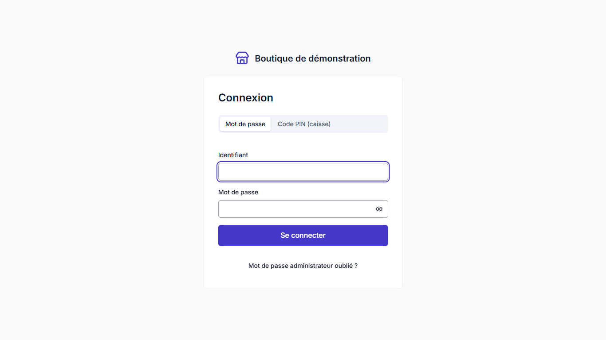

- **Mot de passe** : identifiant et mot de passe.
- **Code PIN** : connexion rapide du vendeur en caisse. Un PIN ne donne que les droits de caisse ; pour une opération
  qui demande plus, l'application demande de se connecter avec le mot de passe.

Après plusieurs essais manqués, l'application impose un délai qui augmente, puis bloque temporairement le compte.

Un compte créé par l'administrateur reçoit un **mot de passe provisoire**, à changer à la première connexion.

La session se **verrouille seule** après une période d'inactivité (5 minutes par défaut, réglable dans Paramètres ›
Sécurité). Pour verrouiller tout de suite en quittant le comptoir : **Ctrl+L** ou **Verrouiller la session** en bas de
la barre latérale. **Se déconnecter** ferme la session.

**Mot de passe administrateur perdu** : sur l'écran de connexion, choisissez **Récupérer le compte administrateur** et
saisissez la clé de récupération. Une nouvelle clé est alors générée : recopiez-la.

## 4. Se repérer dans l'application

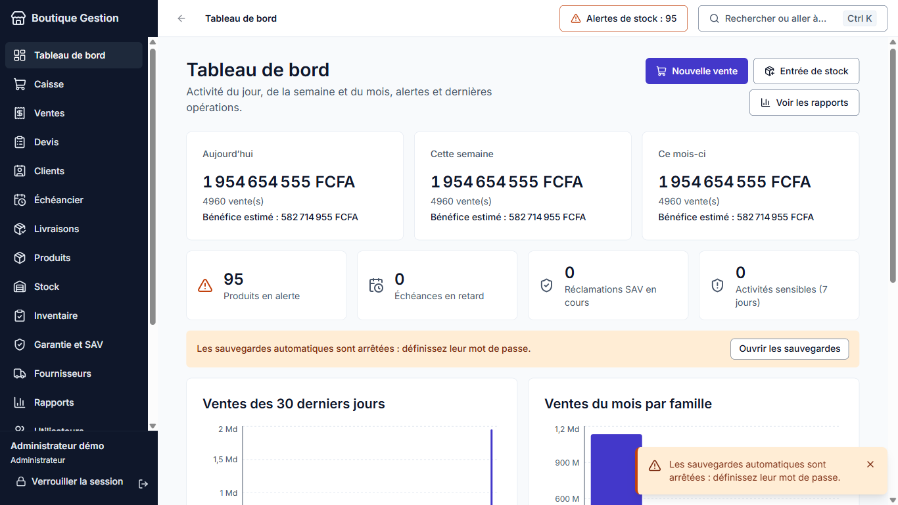

- **Barre latérale** : les modules. Ceux que votre rôle ne permet pas n'apparaissent pas.
- **En-tête** : fil d'Ariane et bouton retour, indicateur d'**alertes de stock**, recherche globale.
- **Recherche globale (Ctrl+K)** : un produit, un IMEI ou un numéro de série, un client, une facture, ou un écran.
  Flèches pour choisir, Entrée pour ouvrir, Échap pour fermer.
- **Apparence** (Paramètres › Apparence) : thème clair, sombre ou celui de Windows, taille du texte, langue (français
  ou anglais). Ces réglages sont propres à l'ordinateur.

Les trois rôles :

| Rôle               | Ce qu'il peut faire                                                                                                                                               |
| ------------------ | ----------------------------------------------------------------------------------------------------------------------------------------------------------------- |
| **Vendeur**        | Caisse, encaissement, impression, devis, clients, livraisons, garantie, consultation des produits et du stock. Ne voit **jamais** les prix d'achat ni les marges. |
| **Gérant**         | En plus : produits et prix, prix d'achat et marges, entrées et sorties de stock, inventaires, fournisseurs, annulations et retours, rapports et exports.          |
| **Administrateur** | Tout, y compris les utilisateurs, les paramètres, les sauvegardes, la mise à jour et le journal d'audit.                                                          |

## 5. Vendre à la caisse

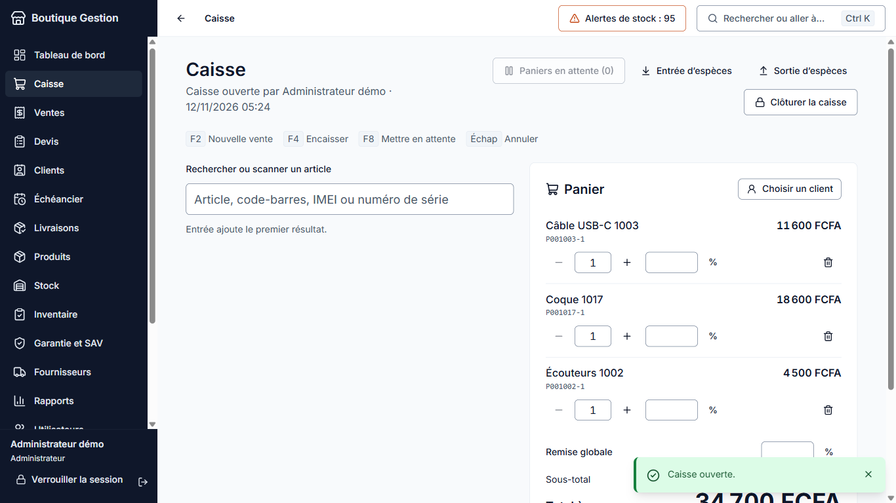

### Ouvrir la caisse

En début de journée, saisissez le **fond de caisse** compté dans le tiroir et cliquez sur **Ouvrir la caisse**.

### Composer le panier

- Le curseur est toujours dans le champ **Rechercher ou scanner un article**. Scannez le code-barres, ou tapez un nom,
  une référence, un IMEI ou un numéro de série ; **Entrée** ajoute le premier résultat. Un bip confirme le scan.
- **Téléphone ou article suivi** (téléviseur, panneau, onduleur, batterie…) : l'application demande l'**unité
  exacte**. Scannez son IMEI ou son numéro de série : on ne vend jamais un appareil « au hasard ».
- **Kit** (ex. kit solaire) : il s'ajoute comme un seul article ; ses composants sortent du stock à la validation.
  Si un composant manque, la vente est refusée en entier.
- **Service** (livraison, installation) : ligne sans stock.
- Quantité : boutons − et +, ou saisie directe. Corbeille pour retirer une ligne.
- **Remise** par ligne ou globale, en pourcentage ou en montant. Elle est plafonnée selon le rôle (10 % pour un
  vendeur et 30 % pour un gérant par défaut, réglable) et ne descend jamais sous le prix minimum d'un article.
- **Client** : **Choisir un client** pour le retrouver par nom ou téléphone, ou le créer sur place. Il est obligatoire
  pour une vente à crédit ou une livraison.

### Encaisser (F4)

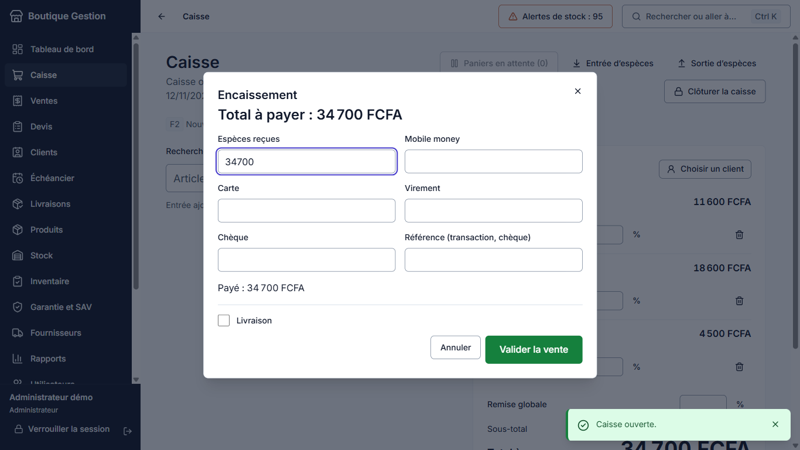

Saisissez les montants reçus par moyen de paiement : **espèces**, **carte**, **Mobile Money**, **virement**,
**chèque**, ou plusieurs à la fois (paiement mixte). La monnaie à rendre s'affiche.

- **Paiement partiel / crédit** : encaissez un acompte et répartissez le reste en **échéances** (dates et montants).
  Le plafond de crédit du client est vérifié.
- **Livraison** : cochez la case, puis indiquez l'adresse et la date prévue.

**Valider la vente** enregistre en une seule fois le panier, les paiements et les sorties de stock : soit tout est
enregistré, soit rien. Le récapitulatif propose le **ticket**, la **facture A4**, le **bon de garantie** et le **bon
de livraison**.

### Mettre en attente (F8)

Un client hésite ? **F8** met le panier de côté pour servir le suivant ; **Paniers en attente** permet de le reprendre.

### Espèces et clôture

- **Entrée d'espèces** et **Sortie d'espèces** (achat de crédit, dépôt en banque…) avec un motif.
- **Clôturer la caisse** en fin de journée : l'application affiche les totaux par moyen de paiement et le montant
  attendu dans le tiroir ; saisissez l'argent réellement compté ; l'écart est enregistré.

## 6. Ventes, retours et annulations

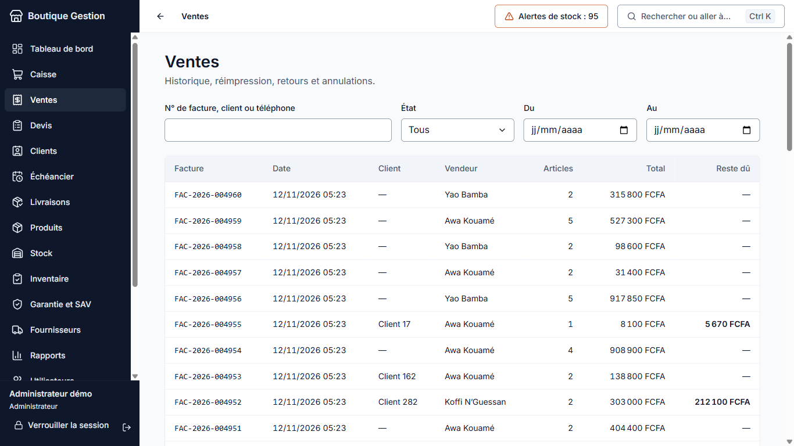

**Ventes** liste toutes les ventes (filtres par période, vendeur, client, état). Le détail montre les articles, les
numéros de série, les garanties restantes, les paiements, les échéances et les retours. Il permet de **réimprimer**
les documents.

- **Retour** (gérant ou administrateur) : article par article, avec un motif ; l'article revient en stock ou part au
  rebut ; le client est remboursé ou reçoit un avoir. On ne peut pas rendre plus que ce qui a été vendu.
- **Annulation** (gérant ou administrateur) : seulement pendant la session de caisse de la vente, avec un motif. Le
  stock est réintégré. Une vente terminée n'est jamais modifiée ni effacée : toute correction est une opération
  inverse, tracée.

## 7. Clients, crédits et échéancier

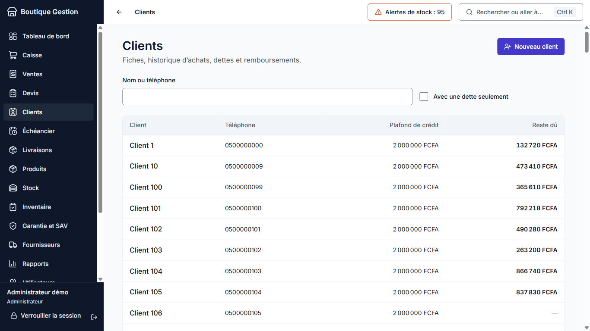

- **Fiche client** : coordonnées, historique des achats, dette en cours.
- **Enregistrer un remboursement** : le montant s'impute aux ventes et échéances les plus anciennes.
- **Échéancier** : échéances **en retard**, **à venir** et toutes ; le tableau de bord signale les retards.
- **Anonymiser** (administrateur) : sur demande du client, son nom, son téléphone, son adresse et ses notes sont
  effacés définitivement ; ses ventes restent, sans ses données personnelles. C'est refusé tant qu'il a un solde,
  une livraison à faire ou un devis en cours.

## 8. Devis et livraisons

- **Devis** : pour les achats importants (installation solaire, téléviseur, sonorisation). Créez le devis, fixez sa
  date de validité, imprimez-le en PDF. Vous pouvez **réserver** les appareils pendant la validité. Un devis accepté se
  **transforme en vente** en un clic ; un devis échu expire seul.
- **Livraisons** : à livrer, livrées, annulées. Marquez une livraison comme faite, imprimez le bon de livraison.

## 9. Produits, caractéristiques et kits

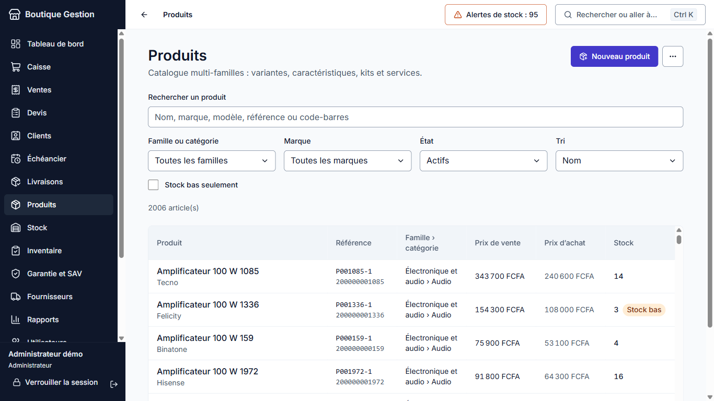

### Familles, catégories et caractéristiques

Quatre familles : **Téléphonie**, **Électronique et audio**, **Électroménager**, **Énergie solaire**. L'administrateur
ajoute des sous-catégories (**Produits › Catégories et caractéristiques**) et définit pour chacune ses
**caractéristiques techniques** : puissance en Wc, tension en V, intensité en A, capacité en Ah, taille en pouces… Une
caractéristique peut être obligatoire et servir de **filtre** de recherche. Les sous-catégories héritent des
caractéristiques de leur catégorie.

### Fiche produit

- Nom, marque, modèle, catégorie, description, photo, taxe, seuil d'alerte, durée de **garantie**.
- **Type** : téléphone, accessoire, électronique, électroménager, solaire, pièce détachée, service ou kit.
- **Suivi** : aucun (câbles, petits accessoires), **numéro de série** (téléviseurs, panneaux, onduleurs…) ou **IMEI**
  (téléphones, toujours). Un article suivi se vend à l'unité.
- **Variantes** : couleur, stockage, RAM, état (neuf, reconditionné, occasion), code-barres, référence, prix de vente
  et prix minimum. Chaque variante a son propre stock.
- **Kits** : composants et quantités. La fiche compare le prix du kit à la somme des composants.
- **Archiver** un produit le retire de la vente sans effacer son historique. Il peut être restauré.

### Importer et exporter

**Produits › Importer** lit un fichier Excel ou CSV avec les colonnes : Nom, Marque, Catégorie, Type, Suivi, Modèle,
Description, Taxe, Seuil d'alerte, Garantie (mois), Poids (kg), Référence, Code-barres, Couleur, Stockage (Go),
RAM (Go), État, Prix de vente, Prix minimum, Prix d'achat, plus une colonne `attr:<code>` par caractéristique. Le plus
simple : **exportez** d'abord le catalogue pour obtenir un modèle. L'import montre l'analyse ligne par ligne avant
confirmation ; il se fait en entier ou pas du tout.

### Étiquettes

**Étiquettes** produit un PDF de codes-barres (planche A4 ou rouleau), par variante ou par appareil suivi (avec son
numéro de série).

## 10. Stock, entrées de marchandise et fournisseurs

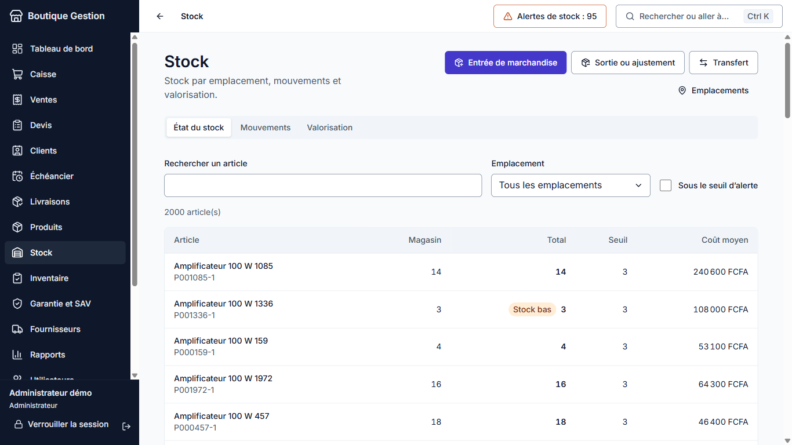

**Stock** a trois onglets : l'**état** par article et par emplacement (alertes colorées), l'**historique des
mouvements** (date, article, numéro, quantité, stock après, motif, document, utilisateur) et la **valorisation**
(au coût moyen et au prix de vente, par emplacement et par famille ; réservée à qui voit les prix d'achat).

- **Entrée de marchandise** : choisissez le fournisseur et l'emplacement, scannez les articles, saisissez quantités et
  prix d'achat, et pour chaque appareil suivi son IMEI ou son numéro de série (IMEI 2 facultatif). Un bon
  `BR-AAAA-NNNNN` est créé ; le coût moyen pondéré est recalculé. Un paiement au fournisseur peut être saisi en même
  temps.
- **Sortie** (perte, casse, vol, usage interne) et **ajustement** : motif obligatoire.
- **Transfert** entre emplacements (magasin, dépôt) et **retour au fournisseur**.
- **Emplacements** : créez le dépôt, choisissez l'emplacement par défaut.
- **Fournisseurs** : fiche, historique des entrées, paiements, **reste dû**.

Le stock ne devient jamais négatif : une vente ou une sortie au-delà du stock est refusée.

## 11. Inventaire

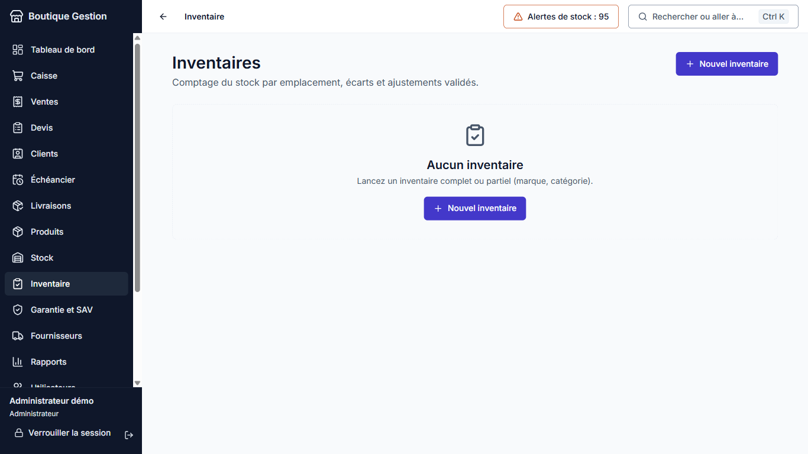

1. **Nouvel inventaire** : complet, par marque ou par famille/catégorie, pour un emplacement.
2. **Comptage** : scannez les articles (le numéro de série d'abord pour un appareil suivi) ou saisissez les quantités.
   Mettez explicitement à zéro ce qui n'a pas été trouvé.
3. **Écarts** : stock attendu, stock compté, écart, et sa valeur pour qui voit les coûts.
4. **Validation** (gérant ou administrateur ; double contrôle possible dans les paramètres) : les ajustements sont
   créés, les appareils manquants sortent du stock, ceux retrouvés y reviennent.
5. **Rapport** PDF et Excel, avec signataires. L'historique des inventaires est conservé.

## 12. Garantie et SAV

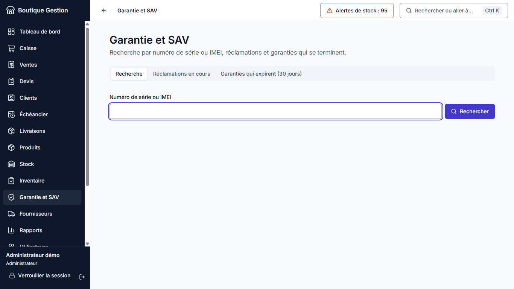

- **Recherche par numéro de série ou IMEI** : vente, facture, client, date de fin de garantie et jours restants,
  historique de l'appareil.
- **Ouvrir une réclamation** : la panne décrite ; une alerte s'affiche si l'appareil est hors garantie.
- Étapes : reçue, envoyée au fournisseur, réparée, remplacée ou refusée, puis clôture avec la solution.
- Listes : réclamations en cours, garanties qui expirent dans les 30 jours.

## 13. Tableau de bord et rapports

Le **tableau de bord** montre les ventes du jour, de la semaine et du mois (avec le bénéfice estimé pour qui voit les
marges), les produits en alerte, les échéances en retard, les réclamations en cours, les activités sensibles (pour
l'administrateur), les graphiques des 30 derniers jours et des familles, les dernières ventes et les derniers
mouvements.

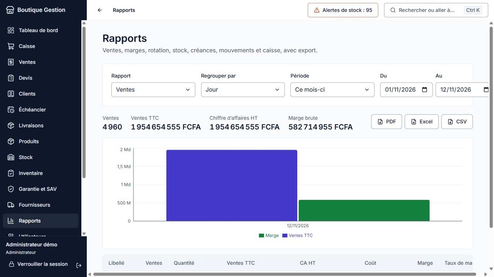

**Rapports** : choisissez le rapport et la période.

- Ventes par jour, mois, vendeur, famille, catégorie, marque ou produit (quantité, ventes TTC, chiffre d'affaires HT,
  coût, marge) ;
- produits les plus et les moins vendus (rotation, couverture en jours) ;
- valorisation du stock ;
- créances clients et dettes fournisseurs ;
- journal des mouvements ;
- caisse (sessions, écarts) ;
- devis et échéances ;
- **activités sensibles** (administrateur) : annulations, remises inhabituelles, ventes sous le coût, ajustements
  répétés, écarts de caisse.

Chaque rapport s'exporte en **PDF, Excel ou CSV** ; chaque export est inscrit au journal d'audit. Les prix d'achat et
les marges n'apparaissent jamais dans les rapports ni les exports d'un vendeur.

## 14. Utilisateurs et journal d'audit

- **Utilisateurs** (administrateur) : créer un compte (rôle, mot de passe provisoire), le désactiver, réinitialiser son
  mot de passe. Le dernier administrateur actif ne peut pas être désactivé.
- **Mon compte** : changer son mot de passe, définir son code PIN de caisse.
- **Journal d'audit** (administrateur) : qui a fait quoi et quand (connexions, ventes, annulations, remises, prix,
  mouvements de stock, exports, paramètres, sauvegardes, mises à jour). Les entrées sont **chaînées** : toute
  modification ou suppression est détectée et signalée au démarrage.

## 15. Paramètres

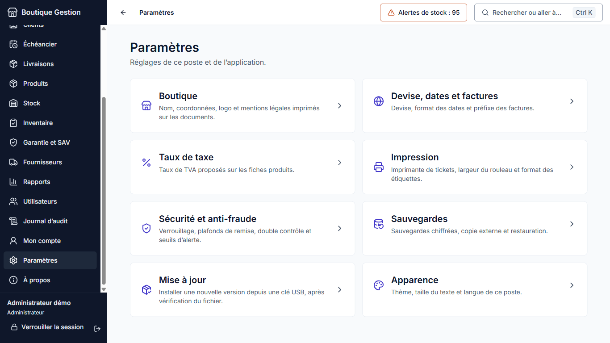

| Section                       | Contenu                                                                                        |
| ----------------------------- | ---------------------------------------------------------------------------------------------- |
| **Boutique**                  | Nom, adresse, téléphone, e-mail, logo, mentions légales (RCCM, NIF) imprimés sur les documents |
| **Devise, dates et factures** | Devise et symbole (FCFA par défaut), format des dates, préfixe des factures                    |
| **Taux de taxe**              | Taux proposés sur les fiches produits (Exonéré, TVA 18 %…)                                     |
| **Impression**                | Imprimante de tickets réseau (ou simulateur), largeur 58 ou 80 mm, ticket d'essai, étiquettes  |
| **Sécurité et anti-fraude**   | Délai de verrouillage, plafonds de remise par rôle, double contrôle, seuils d'alerte           |
| **Sauvegardes**               | Voir [16](#16-sauvegarde-et-restauration)                                                      |
| **Mise à jour**               | Voir [17](#17-mettre-à-jour-lapplication)                                                      |
| **Apparence**                 | Thème, taille du texte, langue (propres à l'ordinateur)                                        |

## 16. Sauvegarde et restauration

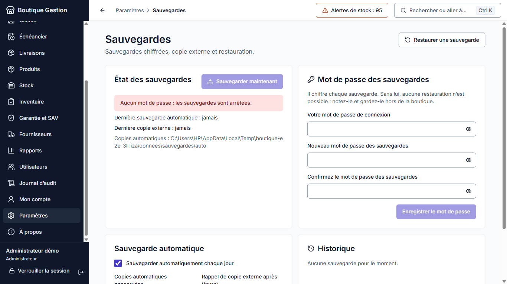

- **Mot de passe des sauvegardes** : à définir une fois. Il chiffre chaque sauvegarde. **Notez-le avec la clé de
  récupération** : sans lui, une sauvegarde ne peut pas être restaurée.
- **Sauvegarde automatique** : une par jour (vérifiée au démarrage puis toutes les heures), les 7 dernières gardées
  (réglable), dans `donnees\sauvegardes\auto`.
- **Sauvegarder maintenant** : choisissez une clé USB ou un disque externe. Un rappel s'affiche si aucune copie
  externe n'a été faite depuis plusieurs jours.
- **Règle 3-2-1** conseillée : 3 copies, sur 2 supports différents, dont 1 hors de la boutique (une clé USB emportée
  le soir, par exemple).
- **Restaurer** : choisissez le fichier `.bgsauv`, saisissez son mot de passe et votre mot de passe de connexion. Le
  fichier est entièrement vérifié avant de toucher à la base actuelle ; une copie de sécurité de la base actuelle est
  faite d'abord, et la base remplacée est mise de côté (jamais effacée). Reconnectez-vous ensuite avec les comptes de
  la sauvegarde.

Une copie de la base est aussi faite automatiquement avant chaque mise à jour de sa structure.

## 17. Mettre à jour l'application

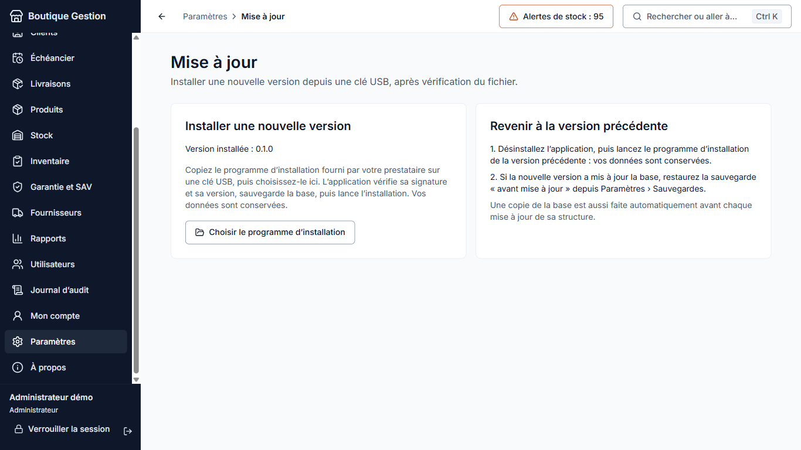

Votre prestataire vous remet le programme d'installation de la nouvelle version, par exemple sur une clé USB.

1. Terminez les ventes en cours.
2. **Paramètres › Mise à jour › Choisir le programme d'installation**, puis choisissez le fichier sur la clé.
3. L'application vérifie le fichier : qu'il s'agit bien de Boutique Gestion, que la version est plus récente, et sa
   **signature**. Une fois l'application installée par un setup signé, seul un fichier signé par le même éditeur est
   accepté. Un fichier non signé n'est proposé que si l'application elle-même ne l'est pas, et après votre
   confirmation explicite. Une signature invalide est toujours refusée.
4. Saisissez votre mot de passe et cliquez sur **Installer la mise à jour**. Une sauvegarde chiffrée de la base est
   faite (il faut donc avoir défini le mot de passe des sauvegardes), puis l'application se ferme et l'assistant
   d'installation s'ouvre. Vos données sont conservées.

Vous pouvez aussi simplement lancer le nouveau setup.exe, application fermée.

**Revenir à la version précédente** : désinstallez l'application, lancez le programme d'installation de la version
précédente, puis, si la nouvelle version avait modifié la base, restaurez la sauvegarde « avant mise à jour ».

## 18. En cas de problème

| Situation                                               | Que faire                                                                                                                                                            |
| ------------------------------------------------------- | -------------------------------------------------------------------------------------------------------------------------------------------------------------------- |
| « La base de données est endommagée »                   | Restaurez la dernière sauvegarde depuis cet écran. La base endommagée est mise de côté, pas effacée.                                                                 |
| « Base verrouillée » (Windows réinstallé, autre compte) | Saisissez la clé de récupération.                                                                                                                                    |
| Mot de passe administrateur oublié                      | Écran de connexion › Récupérer le compte administrateur, avec la clé de récupération.                                                                                |
| Ordinateur **volé, en panne ou infecté**                | Sur un nouveau poste : installez l'application, choisissez **Restaurer une sauvegarde**, prenez la copie externe la plus récente. Changez ensuite les mots de passe. |
| « Journal d'audit altéré » au démarrage                 | Quelqu'un a modifié la base hors de l'application. Prévenez votre prestataire ; consultez le journal.                                                                |
| Imprimante de tickets muette                            | Paramètres › Impression : vérifiez l'adresse, imprimez un ticket d'essai.                                                                                            |
| Le lecteur de codes-barres n'ajoute rien                | Vérifiez que le curseur est dans le champ de recherche de la caisse ; le lecteur doit être en mode clavier et finir par Entrée.                                      |

Les journaux techniques (sans aucune donnée sensible) sont dans `%APPDATA%\Boutique Gestion\logs` : votre prestataire
peut vous les demander.

## 19. Raccourcis clavier

| Touche     | Action                                            |
| ---------- | ------------------------------------------------- |
| **F2**     | Nouvelle vente (ou retour au champ de recherche)  |
| **F4**     | Encaisser                                         |
| **F8**     | Mettre le panier en attente                       |
| **Échap**  | Annuler / fermer la fenêtre                       |
| **Entrée** | Ajouter le premier résultat (caisse)              |
| **Ctrl+K** | Recherche globale                                 |
| **Ctrl+L** | Verrouiller la session                            |
| **Tab**    | Passer au champ suivant (tout se fait au clavier) |
